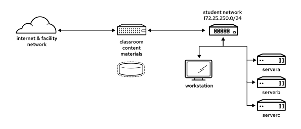
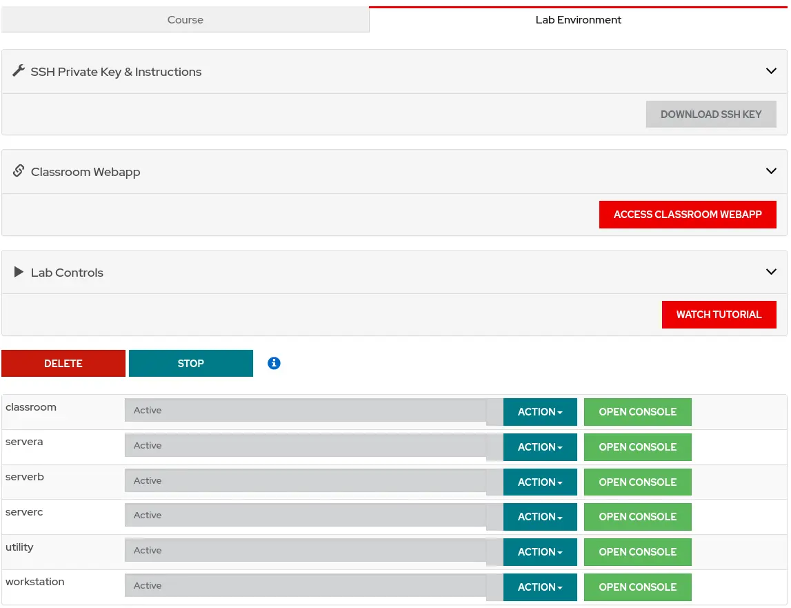

# Orientation to the Classroom Environment

In this course, the main computer system that is used for hands-on learning activities is the workstation machine. You also use three other machines for these activities: the servera, serverb, and serverc machines. These machines are in the lab.example.com DNS domain. These machines are in the lab.example.com DNS domain.  Figure 0.1: Classroom environment

**Table 1. Classroom Machines**

| Machine name                                                    | IP addresses                  | Role                                               |
| --------------------------------------------------------------- | ----------------------------- | -------------------------------------------------- |
| classroom.example.com content.example.com materials.example.com | 172.25.252.254 172.25.254.254 | Server that hosts the required classroom materials |
| utility.lab.example.com                                         | 172.25.250.8                  | Server that hosts course-specific support services |
| workstation.lab.example.com                                     | 172.25.250.9                  | Graphical workstation that students use            |
| servera.lab.example.com                                         | 172.25.250.10                 | Managed server "A"                                 |
| serverb.lab.example.com                                         | 172.25.250.11                 | Managed server "B"                                 |
| serverc.lab.example.com                                         | 172.25.250.12                 | Managed server "C"                                 |

****Controlling Your Systems**** You are assigned remote computers in a Red Hat Online Learning (ROLE) classroom. Self-paced courses are accessed through a web application that is hosted at [rol.redhat.com](http://rol.redhat.com/). Log in to this site with your Red Hat Customer Portal user credentials. **Controlling the Virtual Machines** The virtual machines in your classroom environment are controlled through web page interface controls. The state of each classroom virtual machine is displayed on the Lab Environment tab.  Figure 0.2: An example course lab environment management page **Table 2. Machine States** **Table 2. Machine States**

| Virtual machine state | Description                                                                                                                                               |
| --------------------- | --------------------------------------------------------------------------------------------------------------------------------------------------------- |
| building              | The virtual machine is being created.                                                                                                                     |
| active                | The virtual machine is running and available. If the virtual machine just started, then it might still be starting services.                              |
| stopped               | The virtual machine is shut down. On starting, the virtual machine boots into the same state that it was in before shutdown. The disk state is preserved. |

**Table 3. Classroom Actions**

| Button or action | Description                                                                                                               |
| ---------------- | ------------------------------------------------------------------------------------------------------------------------- |
| CREATE           | Create the ROLE classroom. Creates and starts all the necessary virtual machines for this classroom.                      |
| CREATING         | The ROLE classroom virtual machines are being created. Creation can take several minutes to complete.                     |
| DELETE           | Delete the ROLE classroom. Deletes all virtual machines in the classroom. All saved work on those systems' disks is lost. |
| START            | Start all virtual machines in the classroom.                                                                              |
| STARTING         | All virtual machines in the classroom are starting.                                                                       |
| STOP             | Stop all virtual machines in the classroom.                                                                               |

**Table 4. Machine Actions**

| Button or action   | Description                                                                                                                                                                                                                                                                            |
| ------------------ | -------------------------------------------------------------------------------------------------------------------------------------------------------------------------------------------------------------------------------------------------------------------------------------- |
| OPEN CONSOLE       | Connect to the system console of the virtual machine in a new browser tab. You can log in directly to the virtual machine and run commands, when required. Normally, log in to the workstation virtual machine only, and from there, use ssh to connect to the other virtual machines. |
| ACTION → Start     | Start (power on) the virtual machine.                                                                                                                                                                                                                                                  |
| ACTION → Shutdown  | Gracefully shut down the virtual machine, and preserve disk contents.                                                                                                                                                                                                                  |
| ACTION → Power Off | Forcefully shut down the virtual machine, and still preserve disk contents. This action is equivalent to removing the power from a physical machine.                                                                                                                                   |
| ACTION → Reset     | Forcefully shut down the virtual machine and reset the associated storage to its initial state. All saved work on that system's disks is lost.                                                                                                                                         |

At the start of an exercise, if you are instructed to reset a single virtual machine node, then click → for that specific virtual machine only. At the start of an exercise, if you are instructed to reset all virtual machines, then click → on every virtual machine in the list. To return the classroom environment to its original state at the start of the course, you can click DELETE to remove the entire classroom environment. After the lab is deleted, click CREATE to provision a new set of classroom systems.

## Warning

The DELETE operation cannot be undone. All completed work in the classroom environment is lost. **The Auto-stop and Auto-destroy Timers** The Red Hat Online Learning enrollment entitles you to a set allotment of computer time. To help to conserve your allotted time, the ROLE classroom uses timers, which shut down or delete the classroom environment when the appropriate timer expires. To adjust the timers, locate the two + buttons at the bottom of the course management page. Click the auto-stop + button to add another hour to the auto-stop timer. Click the auto-destroy + button to add another day to the auto-destroy timer. Auto-stop has a maximum of 11 hours, and auto-destroy has a maximum of 14 days. Be careful to keep the timers set when you are working, so that your environment is not unexpectedly shut down. Be careful not to set the timers unnecessarily high, which could waste your subscription time allotment.
