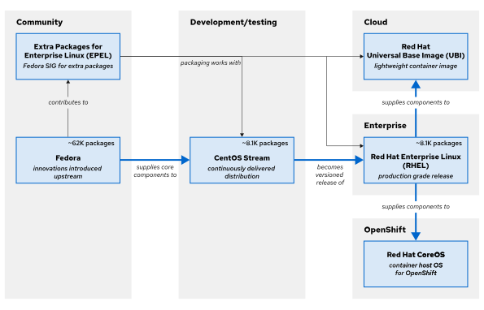
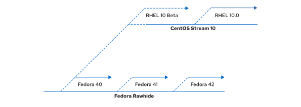

## Chapter 1. Introduction to Red Hat Enterprise Linux

**Abstract**

| Goal     | Define and explain the following concepts: open source, Linux, Linux distributions, and Red Hat Enterprise Linux. |
| -------- | ----------------------------------------------------------------------------------------------------------------- |
| Sections | Getting Started with Red Hat Enterprise Linux (and Quiz)                                                          |

****Getting Started with Red Hat Enterprise Linux****

## Objectives

- Define and explain the purpose of Linux, open source, Linux distributions, and Red Hat Enterprise Linux.

## Why Should You Learn about Linux?

Linux is a critical technology for IT professionals to understand.\
Linux is in widespread use worldwide. Internet users interact with Linux applications and web server systems daily, by browsing the World Wide Web and using e-commerce sites to buy and sell products.\
Linux is in use for much more than the internet. Linux manages point-of-sale systems and the world's stock markets, powers smart TVs and in-flight entertainment systems, and runs most of the top 500 supercomputers in the world. Linux provides the core technologies that power the cloud revolution and the tools to build the latest generations of container-based microservices applications, software-based storage technologies, and big data solutions.\
In the modern data center, Linux and Microsoft Windows are the predominant operating systems. Linux use continues to expand in enterprise, cloud, and device spaces. Due to its widespread adoption, you have many reasons to learn Linux:

- A Windows user needs to interoperate with Linux systems and applications.
- In application development, Linux commonly hosts the application and its runtime.
- In cloud computing, both private and public cloud instances use Linux as the operating system.
- Mobile applications and Internet of Things (IoT) devices commonly run on Linux.
- When looking for new IT career opportunities, Linux skills are in high demand.

## What Makes Linux Great?

If someone asks you "What makes Linux great?", then you have many answers to pick from:\
Linux is open source software.\
Being open source means that you can see how a program or system works. You can also experiment with changes and share them freely for others to use. The open source model means that improvements are easier to make, enabling faster innovation.\
Linux provides a command-line interface (CLI) for easy access and powerful scripting.\
Linux is built around a basic design philosophy that users can perform all administration tasks from the CLI. Using the CLI enables easier automation, deployment, and provisioning, and simplifies both local and remote system administration. Unlike many other operating systems, these capabilities were in the architecture from the start, and result in ease of use and stability.\
Linux is a modular operating system that is designed to easily replace or remove components.\
System components can be upgraded and updated when needed. A Linux system can be a general-purpose development workstation or a purposefully minimized software appliance.

## What Is Open Source Software?

Open source software is software with source code that anyone can use, study, modify, and share.\
Source code is the set of human-readable instructions that are used to make a program. Code might be in interpretive form, such as a script, or compiled into a binary executable that the computer runs directly. Source code becomes copyrighted when created, and the copyright holder controls the terms under which the software can be copied, adapted, and distributed. Users can use the software according to its software license.\
Some software uses closed source or proprietary source code that only the originating person, team, or organization can see, change, or distribute. Proprietary licenses typically restrict the user to running the program, and provide limited or no access to the source.\
Open source software is different. When a copyright holder provides software under an open source license, they grant the user the right to run the program and to view, modify, compile, and redistribute the source to others, royalty-free. Open source licensing promotes collaboration, sharing, transparency, and rapid innovation, because it encourages more people to modify and improve the software and to share enhancements more widely.\
Open source software can still be provided for commercial use. Open source is a critical part of many organizations' commercial operations. Some open source licenses allow code to be reused in proprietary products. Anyone can sell open source code, but open source licensing generally allows the customer to redistribute the source code. Open source vendors such as Red Hat provide commercial support for deploying, managing, and building solutions that are based on open source products.\
Open source has many benefits for the user:

- Control: See what the code does and improve it.
- Training: Learn from real-world code and develop more applications that are useful.
- Security: Inspect sensitive code, and fix it even without the original developers' help.
- Stability: Rely on code that can survive the loss of the original developer.\
  **Types of Open Source Licenses**\
  The developers of open source software can license their software in different ways. The software license terms control how the source can be reused or combined with other code. To be open source, licenses must allow users to freely use, view, change, compile, and distribute the code.\
  Two general classes of open source license are particularly important:
- Copyleft licenses are designed to encourage keeping the code open source.
- Permissive licenses are designed to maximize code reusability.\
  Copyleft, or share-alike licenses, require that anyone who distributes the source code, with or without changes, must pass along the freedom for others to also copy, change, and distribute the code. The advantage of copyleft licenses is that they help to keep existing code, and improvements to that code, open and increase the amount of available open source code. Common copyleft licenses include the GNU General Public License (GPL) and the Lesser GNU Public License (LGPL).\
  Permissive licenses maximize the reusability of source code. You can use the source for any purpose if the copyright and license statements are preserved, including reusing code under more restrictive or proprietary licenses. Although permissive licensing makes it easy to reuse code, it risks encouraging proprietary-only enhancements. Examples of permissive licenses include the MIT/X11 license, the Simplified BSD license, and the Apache Software License 2.0.\
  **Who Develops Open Source Software?**\
  Open source development today is overwhelmingly professional. Open source is no longer solely developed by volunteers. Today, most open source developers work for organizations that pay them to participate with open source projects to construct and contribute the enhancements that the organization and their customers need.\
  Volunteers and the academic community still play a significant role and make vital contributions, especially in emerging technology. The combination of formal and informal development creates a highly dynamic and productive environment.

## What Is a Linux Distribution?

A Linux distribution is an installable operating system that is constructed from a Linux kernel and that supports user programs and libraries. A complete Linux system is developed by multiple independent development communities that work cooperatively on individual components. A distribution provides an easy method to install and manage a working Linux system.\
In 1991, graduate student Linus Torvalds developed a UNIX-like kernel that he named Linux, and licensed it as open source software under the GPL. The kernel is the core of the operating system and manages hardware, memory, and the scheduling of running programs. The Linux kernel is supplemented with other open source software, including utilities and programs from the GNU Project, and the Wayland graphical platform. The Linux kernel also includes other open source components, such as the Sendmail mail server and the Apache HTTP Server, to become a complete open source UNIX-like operating system.\
A major challenge for Linux users is to assemble all these software pieces from many sources. Early Linux developers provided a distribution of prebuilt and tested tools that users could download and install to quickly implement Linux systems.\
Many Linux distributions exist, each with differing goals and support criteria. Generally, distributions have some common characteristics:

- Distributions consist of a Linux kernel and support user-space programs.
- Distributions can be small and single-purpose, or can include thousands of open source programs.
- Distributions provide a means to install and update the software and its components.
- The distribution provider supports the software, and ideally, participates in the development community.

## Who Is Red Hat?

Red Hat is the world's leading provider of open source software solutions, by using a community-powered approach to reliable and high-performance cloud, Linux, middleware, storage, and virtualization technologies. The mission of Red Hat is to be the catalyst in communities of customers, contributors, and partners to create better technology the open source way.\
The role of Red Hat is to help customers to connect with the open source community and their partners to effectively use open source software solutions. Red Hat actively participates in and supports the open source community. Many years of experience have convinced the company of the importance of open source to the future of the IT industry.\
Red Hat is best known for its participation in the Linux community and the Red Hat Enterprise Linux distribution. Red Hat is also active in other open source communities, including middleware projects that are centered on the JBoss developer community. Red Hat also provides virtualization solutions, cloud technologies such as OpenStack and OpenShift, and the Ceph software-based storage project, plus others.

## Red Hat Enterprise Linux Ecosystem

Red Hat Enterprise Linux (RHEL) is Red Hat's commercial production-grade Linux distribution. Red Hat develops and integrates open source software into RHEL through a multistage process.

- Red Hat participates in supporting individual open source projects. It contributes code, developer time, resources, and support, and often collaborates with developers from other Linux distributions, to improve the general quality of software for everyone.
- Red Hat sponsors and integrates open source projects into the community-driven Fedora distribution. Fedora provides a free working environment to serve as a development lab and proving ground for features to be incorporated into CentOS Stream and RHEL products.
- Red Hat stabilizes the CentOS Stream software to be ready for long-term support and standardization, and integrates it into RHEL, the production-ready distribution.\
  \
  Figure 1.1: The Red Hat Enterprise Linux ecosystem\
  **Fedora**\
  Fedora is a community project that produces and releases a free and comprehensive Linux-based operating system. Red Hat sponsors and works with the Fedora community to integrate the latest upstream software into a fast-moving, secure distribution. The Fedora project contributes back to the open source world, and anyone can participate.\
  Fedora prioritizes innovation and excellence above long-term stability. Major updates occur every six months, and bring significant changes. Fedora supports releases for about a year, which means the latest two updates, making it less suited for supportable production use. Fedora remains the source of innovation for the entire Enterprise Linux ecosystem. In general, packages start out in Fedora and are included into CentOS Stream only when they are considered mature in terms of stability, security, performance, and customer demand.\
  **Extra Packages for Enterprise Linux**\
  A Fedora project Special Interest Group (SIG) builds and maintains a community-supported package repository called Extra Packages for Enterprise Linux (EPEL). EPEL versions align with major RHEL releases, and enable RHEL customers to run workloads with software dependencies that are not supported in RHEL. EPEL packages are not included in Red Hat support, but are equivalent to Fedora's level of quality.\
  Typically, EPEL packages are built against RHEL releases. EPEL Next is an additional repository for package maintainers to build against CentOS Stream. This repository is useful when CentOS Stream contains an upcoming RHEL library rebase, or if an EPEL package has a minimum version build requirement that is already in CentOS Stream but not yet in RHEL.\
  **CentOS Stream**\
  CentOS Stream is the upstream project for RHEL. Development of the next RHEL version is transparent and open for community contributions that can directly influence the next release. Patches that are submitted to CentOS Stream are integrated quickly into RHEL, which enables significant changes during the current RHEL version lifecycle. CentOS Stream is a continuous integration and delivery distribution, with tested and stable nightly builds.\
  The CentOS project welcomes contributors worldwide, to give RHEL derivatives the opportunity to contribute to CentOS Stream for their own benefit. The CentOS project also aims to promote sustainable open source software that responds quickly to security exploits, emerging technologies, and changing customer requirements.

## Note

Before 2019, CentOS Linux was a freely available and unsupported distribution that was community-built from Red Hat's source code after each major RHEL release. Although the CentOS community enjoyed having a freely available RHEL clone, this model had disadvantages. Commonly, developer contributions to CentOS Linux were not backported to Fedora or RHEL without considerable duplicate effort. Also, significant delays occurred between a RHEL release and its corresponding CentOS distribution build, with a similar delay for critical RHEL security, driver, and tuning fixes. Red Hat switched to the CentOS Stream model to address these issues.\
A benefit of CentOS Stream is that, as the source for RHEL development, it is available in the same architectures as RHEL, including Intel/AMD x86_64, ARM64, IBM Power, and IBM Z.\
Many innovative technology organizations have proven that CentOS Stream is a viable replacement for the original downstream CentOS Linux. CentOS Stream can be freely downloaded and installed for many use cases, including development and light production. For community users with use cases that are not suitable for a continuously delivered distribution with asynchronous patch releases, Red Hat provides free individual RHEL developer subscriptions for small-scale use, such as demos, prototyping, quality assurance, and limited production.\
**Red Hat Enterprise Linux**\
Red Hat Enterprise Linux (RHEL) is Red Hat's production-ready, commercially supported Linux distribution. In the computing industry, RHEL is acknowledged as the leading platform for open source computing. RHEL is extensively tested and has a worldwide ecosystem of support partners for hardware and software certifications, consulting services, training, and multiyear support and maintenance guarantees.\
Red Hat builds RHEL major releases directly from the CentOS Stream continuous development project, which is sourced from Fedora. The CentOS Stream development model is open and available to all, for feedback and contribution, and the code is prepared to be the next major RHEL release.\
RHEL uses a subscription-based support model, and does not charge license fees for open-source software. Red Hat subscriptions provide product support, maintenance, updates, security patches, and access to the Customer Portal Knowledgebase, utilities, and downloadable releases of Red Hat products.\
The following table lists some key differences between Fedora, CentOS Stream, and RHEL.

|                           | Fedora       | CentOS Stream | RHEL     |
| ------------------------- | ------------ | ------------- | -------- |
| Expected lifecycle        | 12-18 months | 5 years       | 10 years |
| Software vendor certified | No           | Usually not   | Yes      |
| Documentation provided by | Community    | Community     | Red Hat  |
| Expert support available  | No           | No            | Yes      |
| Product security team     | No           | No            | Yes      |
| Security certifications   | No           | No            | Yes      |
| No-cost options           | Yes          | Yes           | Yes      |
| Management tools          | No           | No            | Yes      |

**RHEL-based Image Optimized for Edge**\
Red Hat provides a collection of products and services that are optimized for edge use cases, including a customized RHEL-based image.\
RHEL provides the ability to create purpose-built operating system images with Red Hat Enterprise Linux image builder. With this mechanism, IT teams can build, deploy, and maintain these RHEL images in less time over the life of the system. Image-based deployments are optimized for various edge architectures, and are customizable for specific edge deployments.\
The edge features in RHEL include secure management and scaling capabilities, including zero-touch provisioning, system health visibility, and quick security remediations from within a single interface.\
**Red Hat Enterprise Linux CoreOS**\
Red Hat Enterprise Linux CoreOS (RHCOS) is not a stand-alone operating system. CoreOS is built from RHEL components, and is then released, upgraded, and managed as part of the Red Hat OpenShift Container Platform (RHOCP) for cloud-native applications. RHCOS is fundamentally an image-based RHEL container host, which uses the Container Runtime Interface (CRI-O)-compliant container engine that is integrated in RHOCP. To learn more about Red Hat Enterprise Linux CoreOS, begin by becoming familiar with OpenShift and containers.\
**Red Hat Universal Base Image**\
A Red Hat Universal Base Image (UBI) is essentially a freely redistributable derivative of RHEL. UBI is designed to be a foundation for cloud-native and web application use cases that are developed in containers. All UBI content is a subset of RHEL, with packages sourced from secure RHEL channels, and UBI is supported similar to RHEL when run on Red Hat-supported platforms such as OpenShift and RHEL hosts.\
With UBI, developers can focus their efforts on their application in the container image. UBI is a set of base images, and a set of application images (such as Python, Ruby, Node.js, httpd, or nginx). UBI also consists of a set of RPM repositories, from which you can update any UBI base image to include the package dependencies that your application requires.\
**Red Hat Enterprise Linux Continuous Development**\
In the Fedora upstream community, Fedora Rawhide is the continuous development environment for a regular cadence of public Fedora releases. The community tests and prepares new Linux kernel versions, device drivers, utilities, and applications for the next Fedora distribution. Major RHEL release development begins with selecting the latest Fedora release as the base for the current CentOS Stream continuous development distribution.\
Before a package is formally introduced to CentOS Stream, it undergoes rigorous testing to meet the standards for packages to be included in RHEL. Updates that are posted to CentOS Stream are the same as the updates that are posted to the unreleased minor version of RHEL in development.\
\
Figure 1.2: Red Hat Enterprise Linux continuous development\
Fedora 40 was used as the original code base for RHEL 10 and for CentOS Stream 10. As packages are updated, they are then pushed into CentOS Stream and the nightly build of RHEL. The solid lines indicate distributions or builds that are available for public use.\
Similar to the relationship between Fedora Rawhide and Fedora, CentOS Stream is the continuous development environment for preparing the next minor-version RHEL release. Red Hat performs extensive hardware, integration, dependency, and performance testing before releasing the next public RHEL distribution.

## Obtaining Red Hat Enterprise Linux

Red Hat Enterprise Linux is typically obtained with a paid support subscription, and Red Hat provides multiple ways to obtain RHEL and other RHEL ecosystem products, many without cost.

- Fedora Linux and derivatives are freely available from the Fedora project at [https://fedoraproject.org/](https://fedoraproject.org/), including an emerging version of Fedora CoreOS.
- EPEL and EPEL Next packages are freely available from the EPEL project repositories. Learn how to use EPEL at [https://docs.fedoraproject.org/en-US/epel/](https://docs.fedoraproject.org/en-US/epel/).
- CentOS Stream is freely available at https://www.centos.org/centos-stream/.\
  **RHEL Evaluation Download**\
  An evaluation copy of RHEL is available at [https://www.redhat.com/en/technologies/linux-platforms/enterprise-linux/server/trial](https://www.redhat.com/en/technologies/linux-platforms/enterprise-linux/server/trial). You must have a (free) Customer Portal account for https://access.redhat.com to access and download evaluation products. Product evaluations entitle you to receive updates and support for a limited period. Support ends when the evaluation period ends, but the evaluation software continues to operate. Additional information for many product evaluations is found on the Customer Portal evaluation pages.\
  **Red Hat Developer Subscription**\
  Red Hat provides a freely available subscription for many products through the Red Hat Developer program at [https://developer.redhat.com](https://developer.redhat.com/). With a Red Hat Developer Subscription, developers can quickly create, prototype, test, and demonstrate their applications on the same Red Hat software as on production systems.\
  Create a personal account at https://access.redhat.com, and then register for the Red Hat Developer Subscription program. You can use an existing personal account, but do not use an account that is already associated with any organization's support subscription. The Red Hat Developer Subscription is self-supported, but provides ongoing product updates. Red Hat recommends that individuals who want to gain experience with RHEL and developer products should join the Red Hat Developer program.\
  **Public Cloud Platforms**\
  The major hyperscale public cloud providers, such as Amazon Web Services, Google Cloud Platform, and Microsoft Azure, offer official images for deploying Red Hat Enterprise Linux instances, with subscription management from the Red Hat Cloud Access service. Fully entitled subscriptions for RHEL and Red Hat products are available through the cloud provider, and are portable in hybrid and multivendor clouds.\
  **Containers**\
  You can use Red Hat Universal Base Images and associated content for development and deployment without a Red Hat subscription. For operational support and access to non-UBI tools, containers that are built on UBI must be deployed on a Red Hat-supported platform such as OpenShift or Red Hat Enterprise Linux. Access to non-UBI content requires a Red Hat subscription.\
  **Image Mode for Red Hat Enterprise Linux**\
  Image mode for Red Hat Enterprise Linux 10 is a new deployment and management approach that uses container-native tools to build, deploy, and manage the operating system. With this method, you can deploy the operating system from a bootable container (bootc) image.\
  You can add software or dependencies to build the image, and then push it to a registry. Image mode for RHEL limits infrastructure drift, enables scalability, and simplifies troubleshooting.
