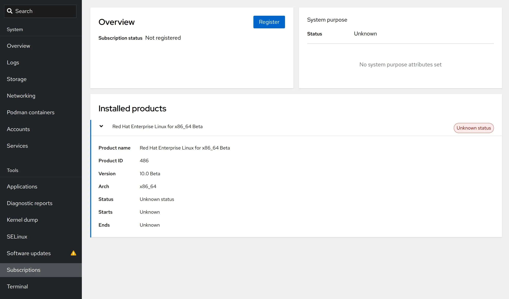
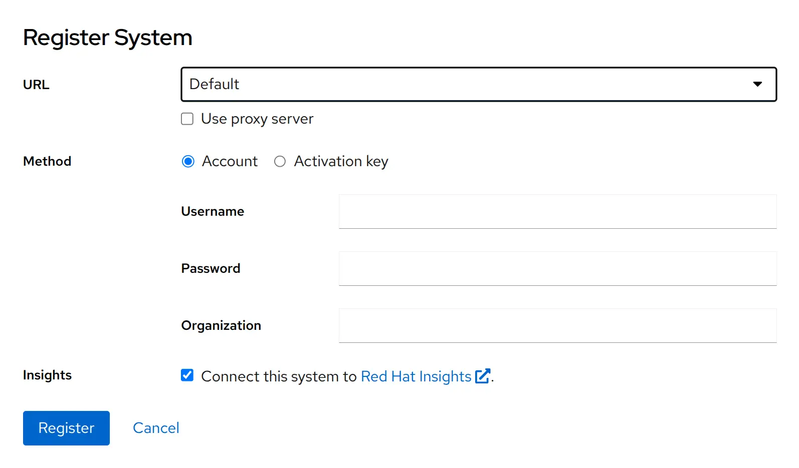
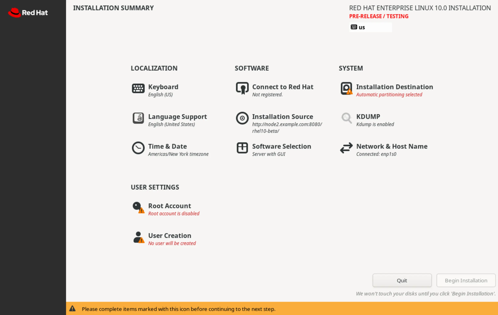
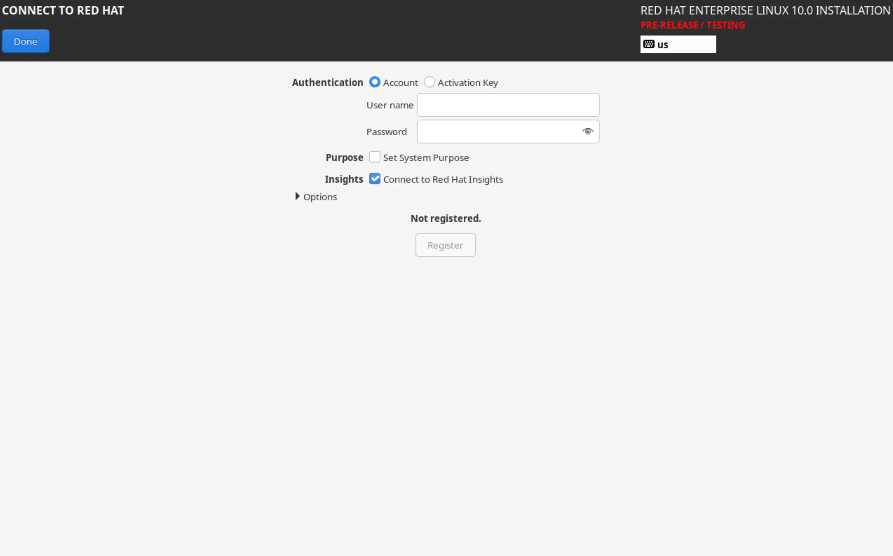

## Chapter 4. Registering Systems for Red Hat Support

**Abstract**

| Goal     | Register a system by using your Red Hat account to get support services and software that Red Hat provides. |
| -------- | ----------------------------------------------------------------------------------------------------------- |
| Sections | Registering Systems for Red Hat Support (and Quiz)                                                          |

****Registering Systems for Red Hat Support****

## Objectives

- Register a system by using your Red Hat account.

## The Benefits of a Red Hat Subscription

Red Hat provides access to software repositories through the Red Hat Content Delivery Network (CDN) in a subscription-based model. Software repositories provide regularly updated packages, including security patches, bug fixes, and enhancements. Customers with active subscriptions can access Red Hat content repositories to install new software packages and to stay up-to-date with the latest updates. In addition to software updates, an active subscription provides customers with technical resources such as Customer Portal Labs, Knowledgebase solutions, documentation, Red Hat Insights, and support expertise. In 2024, Red Hat transitioned to a subscription model named Simple Content Access (SCA). This access-based subscription model enforces the existence of a valid subscription on a per-organization basis, eliminating the need to attach subscriptions on a per-system level. The new model reduces complexity in subscription management and tooling. As part of this migration, customer-facing
subscription services moved from the Red Hat Customer Portal ([https://access.redhat.com](https://access.redhat.com/)) to the Red Hat Hybrid Cloud Console ([https://console.redhat.com](https://console.redhat.com/)). The Hybrid Cloud Console provides a unified experience for systems management and closer integration with Red Hat Insights.

## Registering a RHEL System

You can use different options to register a system to the Red Hat subscription service. For example, you might use the graphical RHEL web console or command-line tools such as remote host configuration (rhc) or subscription manager (subscription-manager). You can use these tools to perform the following actions with your systems:

- Register a system to associate it with a Red Hat account that has an active subscription. During registration, the system receives unique identity certificates for authentication to the Red Hat subscriptions service.
- Enable additional repositories to provide access to software packages as needed. Default repositories are automatically enabled for installed products, which provides immediate access to content.
- Review and track available or consumed entitlements on the Subscription Inventory page of the Hybrid Cloud Console.
- Optionally, register with Red Hat Insights for predictive analytics and proactive issue resolution. **Registering a System with the rhc Tool** The rhc command-line tool is available for registering RHEL 8.8 and later systems. By default, the rhc tool enables three features: content, analytics and remote-management. These features allow your system to access content repositories and enables the Red Hat Insights analytics and remediation services with a single command. The rhc command-line tool is available for registering RHEL 8.8 and later systems. By default, the rhc tool enables three features: content, analytics and remote-management. These features allow your system to access content repositories and enables the Red Hat Insights analytics and remediation services with a single command. To use the rhc tool, you must authenticate by using a Red Hat account that has a valid subscription. Additionally, you must have root access on the system to be able to register it. To use the rhc
  tool, you must authenticate by using a Red Hat account that has a valid subscription. Additionally, you must have root access on the system to be able to register it.

```
root@host:~# rhc connect
Connecting host.example.com to Red Hat.
This might take a few seconds.

Features preferences: [✓]content, [✓]analytics, [✓]remote-management

Username: red-hat-username
Password:
```

```
red-hat-password
```

```
 [✓] Connected to Red Hat Subscription Management
  [✓] Content ... Red Hat repository file generated
  [✓] Analytics ... Connected to Red Hat Insights
  [✓] Remote Management ... Activated the yggdrasil service

Successfully connected to Red Hat!

Manage your connected systems: https://red.ht/connector
```

The rhc command enables all three of the main features by default. If you want to enable only access to content repositories without registering to Red Hat Insights, then you can disable the analytics and remote-management features during registration. You can disable these features by using the rhc connect command with the --disable-feature option.

```
root@host:~# rhc connect --disable-feature=analytics,remote-management
...output omitted...
Features preferences: [✓]content, [ ]analytics, [ ]remote-management

Username:
```

```
red-hat-username
```

```
Password: red-hat-password

 [✓] Connected to Red Hat Subscription Management
  [✓] Content ... Red Hat repository file generated
  [ ] Analytics ... Connecting to Red Hat Insights disabled
  [ ] Management .... Starting yggdrasil service disabled (required feature "analytics" is disabled)
...output omitted...
```

When you go to the Hybrid Cloud Console to check this particular system, expect the dashboard to display the Your insights-client is not reporting warning. The inventory information for this system is limited because of the lack of data collection. **Using an Activation Key with the rhc Tool** To register a system securely in a more automated way, use the rhc connect command along with an activation key and your organization identifier (numeric identifier). This method is more secure than providing personal usernames and passwords. An activation key is a pre-shared authentication token that you can create and manage in the Hybrid Cloud Console. On the dashboard, click Insights for RHEL, and then select → → . When you create an activation key, you have the option to associate the key with the latest RHEL version or to lock the key to a specific earlier release. You can optionally also define the system purpose, which is a tagging mechanism to help identify hosts in the inventory later.
You can also define additional repositories for the activation key, which can further simplify configuring a system during registration. The following example shows how to use an activation key with the rhc command. The following example shows how to use an activation key with the rhc command.

```
root@host:~# rhc connect --activation-key=<activation_key_name> \
--organization=<organization_ID>
```

```
```

```
...output omitted...
Successfully connected to Red Hat!

Manage your connected systems: https://red.ht/connector
```

**Unregistering a System with the rhc Tool** To unregister your system, use the rhc disconnect command:

```
root@host:~# rhc disconnect
Disconnecting host.example.com from Red Hat.
This might take a few seconds.

 [✓] Deactivated the yggdrasil service
 [✓] Disconnected from Red Hat Insights
 [✓] Disconnected from Red Hat Subscription Management

Manage your connected systems: https://red.ht/connector
```

**Registering a System with the subscription-manager Tool** The rhc command is the preferred tool to register systems, but the rhc command is not available for RHEL 8.7 or earlier releases. As an alternative, you can use the subscription-manager command to register your systems. The subscription-manager tool is also helpful in cases where you want to enable repository access without connecting to Red Hat Insights. In RHEL 10, several subscription-manager modules that were related to attaching subscriptions on a per-system basis have been removed. However, the subscription-manager tool is not superseded or deprecated in RHEL 10, and continues to function similarly to its earlier versions. Because of the transition to Simple Content Access, registering a system by using the subscription-manager tool is accomplished in a single step:

```
root@host:~# subscription-manager register
Registering to: subscription.rhsm.redhat.com:443/subscription
Username:
```

```
red-hat-username
```

```
Password:
```

```
red-hat-password
```

```
The system has been registered with ID: 686c73e1-3780...
The registered system name is: host.example.com
```

If you have created an activation key in the Hybrid Cloud Console, then you can use it to register your system without using your username and password:

```
root@host:~# subscription-manager register \
--activationkey <activation_key_name> --org <organization_ID>
```

```
```

```
The system has been registered with ID: 361d5774-76e0...
The registered system name is: host.example.com
```

To verify the registration status of your system, you can use the subscription-manager status command:

```
root@host:~# subscription-manager status
+-------------------------------------------+
   System Status Details
+-------------------------------------------+
Overall Status: Registered
```

To verify subscription usage, you must visit the Hybrid Cloud Console because the subscription-manager tool no longer reports entitlement usage on a per-system basis. The subscription-manager command cannot connect your system to Red Hat Insights. After registration, you can use the insights-client command to enable Red Hat Insights: The subscription-manager command cannot connect your system to Red Hat Insights. After registration, you can use the insights-client command to enable Red Hat Insights:

```
root@host:~# insights-client --register
Successfully registered host host.example.com
Automatic scheduling for Insights has been enabled.
Starting to collect Insights data for host.example.com
Writing RHSM facts to /etc/rhsm/facts/insights-client.facts ...
Uploading Insights data.
Successfully uploaded report from host.example.com to account 606...
View the Red Hat Insights console at https://console.redhat.com/insights/
```

**Setting System Purpose Attributes** System purpose is an optional tagging mechanism that helps to filter your inventory. You can set the following attributes and values by using the subscription-manager command: System purpose is an optional tagging mechanism that helps to filter your inventory. You can set the following attributes and values by using the subscription-manager command: **Role** **Role**

- Red Hat Enterprise Linux Server
- Red Hat Enterprise Linux Workstation
- Red Hat Enterprise Linux Compute Node **Service-Level Agreement**
- Premium
- Standard
- Self-Support **Usage**
- Production
- Development/Test
- Disaster Recovery Use the subscription-manager syspurpose command to set relevant system purpose attributes:

```
root@host:~# subscription-manager syspurpose role \
--set 'Red Hat Enterprise Linux Workstation'
role set to "Red Hat Enterprise Linux Workstation".

root@host:~#
```

```
subscription-manager syspurpose service-level \
```

```
--set 'Premium'
service_level_agreement set to "Premium".

root@host:~#
```

```
subscription-manager syspurpose usage \
```

```
--set 'Development/Test'
```

```
```

```
usage set to "Development/Test".
```

The syspurpose subcommand also supports the --list option to help list the available values for each attribute. For example, the following command checks the list of available values for the usage attribute:

```
root@host:~# subscription-manager syspurpose usage --list
+-------------------------------------------+
               Available usage
+-------------------------------------------+
 - Development/Test
```

**Unregistering a System with the subscription-manager Tool** With the subscription-manager tool, removing a registration is a one-step process: With the subscription-manager tool, removing a registration is a one-step process:

```
root@host:~# subscription-manager unregister
Unregistering from: subscription.rhsm.redhat.com:443/subscription
System has been unregistered.
```

**Registering a System with the RHEL Web Console** If you prefer a graphical user interface to command-line tools, then the RHEL web console is a good alternative. To register a system with the web console, you must log in as a privileged user. Click Subscriptions to see your current subscription status and the list of installed products.  Figure 4.1: Web console overview The start the registration process, click Register in the Overview section.  Figure 4.2: Web console registration In the Register System dialog box, provide the username and the password for your Red Hat account, and then click Register to register the system. Alternatively, instead of providing a username and password, you can provide an activation key along with an organization identifier. By default, registering to Red Hat Insights is preselected. **Registering a System During Installation**
If you are deploying RHEL 10 on a bare-metal or virtual machine, then the Anaconda installer can register your target system before package installation begins. In the interactive Anaconda interface, click Connect to Red Hat to access the registration dialog.  Figure 4.3: Anaconda installer summary You can authenticate by using a username and password, or by using an activation key. Optionally, you can also set the system purpose and register to Red Hat Insights.  Figure 4.4: Anaconda installer registration If you wish to register your system as part of an automated Kickstart installation, then you can use the rhsm Kickstart command. Note that the rhsm Kickstart command requires an activation key and organization identifier. If you wish to register your system as part of an automated Kickstart installation, then you can use the rhsm Kickstart
command. Note that the rhsm Kickstart command requires an activation key and organization identifier.

## Inspecting Identity Certificates

A registered system stores several certificates under the /etc/pki directory. The /etc/pki/product-default certificates The /etc/pki/product-default certificates Identify the Red Hat products that are installed on the system. The /etc/pki/consumer certificate and key pair The /etc/pki/consumer certificate and key pair Identifies the system. The /etc/pki/entitlement certificate and key pair The /etc/pki/entitlement certificate and key pair Authenticates the system to repositories. You can use the rct cat-cert command to inspect the certificates in more detail: You can use the rct cat-cert command to inspect the certificates in more detail:

```
root@host:~# rct cat-cert /etc/pki/product-default/479.pem

+-------------------------------------------+
	Product Certificate
+-------------------------------------------+

Certificate:
	Path: /etc/pki/product-default/479.pem
	Version: 1.0
	Serial: 271555466504741450059712551000979178078433728276
	Start Date: 2024-08-15 06:16:49+00:00
	End Date: 2044-08-15 06:16:49+00:00

...output omitted...

Product:
	ID: 479
	Name: Red Hat Enterprise Linux for x86_64
	Version: 10.0
	Arch: x86_64
	Tags: rhel-10,rhel-10-x86_64
	Brand Type:
	Brand Name:
```
