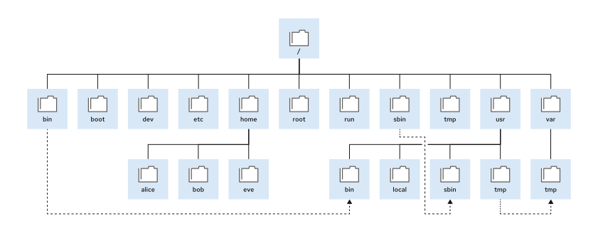

## Chapter 6. Navigating the File-system Hierarchy

**Abstract**

| Goal                                | Describe the organization of files in the Linux file-system hierarchy and specify files by name, by using relative paths or absolute paths. |
| ----------------------------------- | ------------------------------------------------------------------------------------------------------------------------------------------- |
| Sections                            | The Linux File-system Hierarchy (and Quiz)                                                                                                  |
| Specifying Files by Name (and Quiz) |                                                                                                                                             |

****The Linux File-system Hierarchy****

## Objectives

- Describe how Linux files are organized, and the purposes of various directories in the file-system hierarchy.

## The File-system Hierarchy

The Linux system stores all files on file systems, which are organized into a single inverted tree known as a file-system hierarchy. This hierarchy is an inverted tree because the tree root is at the top, and the branches of directories and subdirectories stretch below the root.\
\
Figure 6.1: Significant file-system directories in Red Hat Enterprise Linux 10\
The root directory, which is denoted by a forward slash (/), is at the top of the file-system hierarchy. The forward slash (/) is also used as a directory separator in file names. For example, if etc is a subdirectory of the / directory, then refer to that directory as /etc. Likewise, if the /etc directory contains a file that is named issue, then refer to that file as /etc/issue.\
The root directory, which is denoted by a forward slash (/), is at the top of the file-system hierarchy. The forward slash (/) is also used as a directory separator in file names. For example, if etc is a subdirectory of the / directory, then refer to that directory as /etc. Likewise, if the /etc directory contains a file that is named issue, then refer to that file as /etc/issue.\
Subdirectories of the / directory are used for standardized purposes to organize files by type and purpose to make it easier to find files. For example, in the root directory, the /boot subdirectory is used for storing files to boot the system.\
Subdirectories of the / directory are used for standardized purposes to organize files by type and purpose to make it easier to find files. For example, in the root directory, the /boot subdirectory is used for storing files to boot the system.

## Note

The following terms describe the various types of file-system directory contents:

- Static content remains unchanged until explicitly edited or reconfigured.
- Dynamic or variable content might be modified or appended by active processes.
- Persistent content remains after a reboot, such as configuration settings.
- Runtime content from a process or from the system is deleted on reboot.\
  The following table lists some significant directories on the system by name and purpose.\
  **Table 6.1. Significant Red Hat Enterprise Linux Directories**

| Location                                  | Purpose                                                                                                                                                                                                                                                                                                                   |
| ----------------------------------------- | ------------------------------------------------------------------------------------------------------------------------------------------------------------------------------------------------------------------------------------------------------------------------------------------------------------------------- |
| /boot                                     | Files to start the boot process.                                                                                                                                                                                                                                                                                          |
| /dev                                      | Special device files that the system uses to access hardware.                                                                                                                                                                                                                                                             |
| /etc                                      | System-specific configuration files.                                                                                                                                                                                                                                                                                      |
| /home                                     | Home directory, where regular users store their data and configuration files.                                                                                                                                                                                                                                             |
| /root                                     | Home directory for the administrative superuser, root.                                                                                                                                                                                                                                                                    |
| /run                                      | Runtime data for processes that started since the last boot. This data includes process ID files and lock files. The contents of this directory are re-created on reboot. This directory consolidates the /var/run and /var/lock directories from earlier versions of Red Hat Enterprise Linux.                           |
| /tmp                                      | A world-writable space for temporary files. Files that are not accessed, changed, or modified for 10 days are deleted from this directory automatically. The /var/tmp directory is also a temporary directory, in which files that are not accessed, changed, or modified in more than 30 days are deleted automatically. |
| /usr                                      | Installed software, shared libraries, including files, and read-only program data. Significant subdirectories in the /usr directory include the following commands:                                                                                                                                                       |
| /usr/bin: User commands                   |                                                                                                                                                                                                                                                                                                                           |
| /usr/sbin: System administration commands |                                                                                                                                                                                                                                                                                                                           |
| /usr/local: Locally customized software   |                                                                                                                                                                                                                                                                                                                           |
| /var                                      | System-specific variable data should persist between boots. Files that dynamically change, such as databases, cache directories, log files, printer-spooled documents, and website content, might be found under the /var directory.                                                                                      |

****Important****\
In Red Hat Enterprise Linux 7 and later, four directories in the root directory contain the same files as their counterparts in the /usr directory:\
In Red Hat Enterprise Linux 7 and later, four directories in the root directory contain the same files as their counterparts in the /usr directory:

- /bin and /usr/bin
- /sbin and /usr/sbin
- /lib and /usr/lib
- /lib64 and /usr/lib64\
  Earlier versions of Red Hat Enterprise Linux had distinct directories with different sets of files. In Red Hat Enterprise Linux 7 and later, the directories in the / directory are symbolic links to the matching directories in the /usr directory.

## References

hier(7) man page
