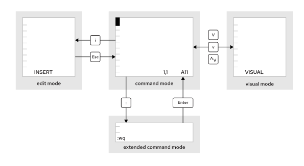

# Editing Text Files from the Command Line

## Objectives

- Create, view, and edit text files by using the Vim editor.

## Editing Files with Vim

The fundamental design principle of Linux is that it supports storing information and configuration settings in text-based files. These files follow various structures such as lists of settings, INI-like formats, structured XML or YAML, and others. The advantage of storing files in a text-based structure is that they can be edited with any text editor.\
Vim is an improved version of the vi editor, which is distributed with Linux and UNIX systems. Vim is a highly configurable and efficient editor that provides split-screen editing, color formatting, and highlighting for editing text.\
**Benefits of the Vim Editor**\
When a system uses a text-only shell prompt, you should know how to use at least one text editor for editing files. You can then edit text-based configuration files from a terminal window or remote logins through the ssh command or the web console. You also do not need access to a graphical desktop to edit files on a server, and that server might not need to run a graphical desktop environment.\
The key reason to learn Vim is that it is almost always installed by default on a server for editing text-based files. The Portable Operating System Interface (POSIX) standard specifies the vi editor on Linux, and many other UNIX-like operating systems largely do likewise.\
The key reason to learn Vim is that it is almost always installed by default on a server for editing text-based files. The Portable Operating System Interface (POSIX) standard specifies the vi editor on Linux, and many other UNIX-like operating systems largely do likewise.\
Vim is also used often as the vi implementation on other standard operating systems or distributions. For example, macOS currently includes a lightweight installation of Vim by default. So, Vim skills that are learned for Linux might also prove useful elsewhere.\
Vim is also used often as the vi implementation on other standard operating systems or distributions. For example, macOS currently includes a lightweight installation of Vim by default. So, Vim skills that are learned for Linux might also prove useful elsewhere.\
**Installing Vim**\
You can install the Vim editor in Red Hat Enterprise Linux by using one of two packages. These packages provide different features and Vim commands for editing text-based files.\
With the vim-minimal package, you might install the vi editor with core features. This lightweight installation includes only the core features and the basic vi command. You can open a file for editing by using the vi command.\
With the vim-minimal package, you might install the vi editor with core features. This lightweight installation includes only the core features and the basic vi command. You can open a file for editing by using the vi command.

```
user@host:~$ vi filename
```

Alternatively, you can use the vim-enhanced package to install the Vim editor. This package provides a more comprehensive set of features, an online help system, and a tutorial program. Use the vim command to start Vim in this enhanced mode.

```
user@host:~$ vim filename
```

The core features of the Vim editor are available in both commands.\
If vim-enhanced is installed, then a shell alias is set so that if regular users run the vi command, then they automatically get the vim command instead. This alias does not apply to the root user and to other users with UIDs below 200 (which system services use).\
If vim-enhanced is installed and a regular user wants to use the vi command, then they might have to use the \vi command to override the alias temporarily. You can use \vi --version and vim --version to compare the feature sets of the two commands.\
If vim-enhanced is installed and a regular user wants to use the vi command, then they might have to use the \vi command to override the alias temporarily. You can use \vi --version and vim --version to compare the feature sets of the two commands.\
**Vim Operating Modes**\
The Vim editor offers various modes of operation such as command mode, extended command mode, edit mode, and visual mode. As a Vim user, always verify the current mode, because the effect of keystrokes varies between modes.\
\
Figure 8.1: Moving between Vim modes\
When you first open Vim, it starts in command mode, which is used for navigation, cut and paste, and other text modification. Pressing the required keystroke accesses specific editing functions.

- An **I** keystroke enters insert mode, where all typed text becomes file content. Pressing **Esc** returns to command mode.
- A **V** keystroke enters visual mode, where multiple characters might be selected for text manipulation. Use **Shift**+**V** for multiline and **Ctrl**+**V** for block selection. To exit the visual mode, use the **V**, **Shift**+**V**, or **Ctrl**+**V** keystrokes.
- The **:** keystroke begins extended command mode for tasks such as writing the file (to save it) and quitting the Vim editor.

## Note

If you are unsure which mode Vim is using, then press **Esc** a few times to get back into command mode. You can safely press the **Esc** key in command mode repeatedly.\
**The Basic Vim Workflow**\
Vim has efficient, coordinated keystrokes for advanced editing tasks. Although Vim provides many benefits, Vim's capabilities can overwhelm new users.

## Note

First, take the time to familiarize yourself with the basic Vim capabilities. Then, expand your Vim vocabulary by learning more Vim keystrokes.\
The exercise for this section uses the vimtutor command. This tutorial, from the vim-enhanced package, is an excellent way to learn the core Vim functions.\
Red Hat recommends that you learn the following Vim keys and commands.

- The **U** key undoes the most recent edit.
- The **X** key deletes a single character.
- The **H** key moves the cursor left.
- The **J** key moves the cursor down.
- The **K** key moves the cursor up.
- The **L** key moves the curser right.
- The **A** key appends text at the end of the current line.
- The :w command writes (saves) the file and remains in command mode for more editing.
- The :wq command writes (saves) the file and quits Vim.
- The :q! command quits Vim, and discards all file changes made after the last write.\
  **Rearranging Existing Text**\
  In Vim, you can yank and put (copy and paste), by using the **Y** and **P** command characters. Position the cursor on the first character to select, and then enter visual mode. Use the arrow keys to expand the visual selection. When ready, press **Y** to yank the selection into memory. Position the cursor at the new location, and then press **P** to put the selection at the cursor.\
  In Vim, you can yank and put (copy and paste), by using the **Y** and **P** command characters. Position the cursor on the first character to select, and then enter visual mode. Use the arrow keys to expand the visual selection. When ready, press **Y** to yank the selection into memory. Position the cursor at the new location, and then press **P** to put the selection at the cursor.\
  **Visual Mode in Vim**\
  Visual mode is useful to highlight and manipulate text in different lines and columns. You can enter various visual modes in Vim by using the following key combinations.
- Character mode : **V**
- Line mode : **Shift**+**V**
- Block mode : **Ctrl**+**V**\
  Character mode highlights sentences in a block of text. The word VISUAL displays at the bottom of the screen. Press **V** to enter visual character mode. Press **Shift**+**V** to enter line mode. VISUAL LINE displays at the bottom of the screen.\
  Visual block mode is an effective method for manipulating data files. Press the **Ctrl**+**V** keystroke to enter the visual block from the cursor. VISUAL BLOCK displays at the bottom of the screen. Use the arrow keys to highlight the section to change.\
  **Vim Configuration Files**\
  The /etc/vimrc and ~/.vimrc configuration files alter the behavior of the Vim editor for the entire system or for a specific user, respectively. With these configuration files, you can specify behavior such as the default tab spacing, syntax highlighting, color schemes, and more. Modifying the behavior of the Vim editor is particularly useful when working with languages such as YAML, which have strict syntax requirements. Consider the following ~/.vimrc file, which sets the default tab stop (denoted by the ts characters) to two spaces when editing YAML files. The file also includes the set number parameter to display line numbers when editing any file.

```
user@host:~$ cat ~/.vimrc
autocmd FileType yaml setlocal ts=2
set number
```

A complete list of vimrc configuration options is available in the references.
