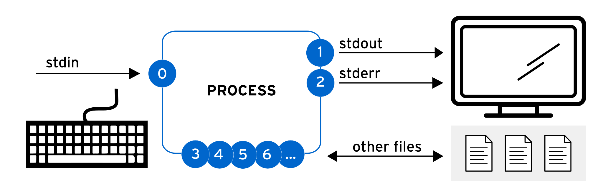
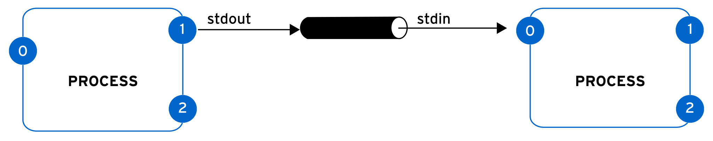
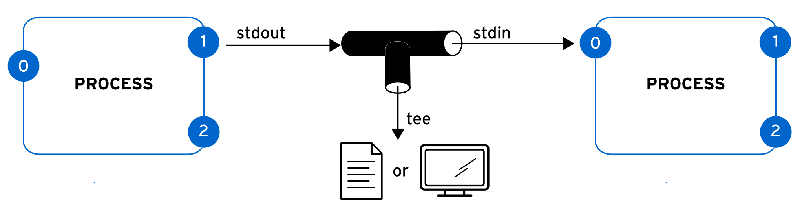

## Chapter 9. Redirecting Shell Input and Output

**Abstract**

| Goal                                      | Redirect the output of commands and input to commands, by using Bash. |
| ----------------------------------------- | --------------------------------------------------------------------- |
| Sections                                  | Redirecting Output to Files and Programs (and Guided Exercise)        |
| Redirecting Shell Input and Output (Quiz) |                                                                       |

****Redirecting Output to Files and Programs****

## Objectives

- Save output or errors to a file with shell redirection, and process command output through multiple command-line programs with pipes.

## Standard Input, Standard Output, and Standard Error

A running program, or process, reads input and writes output. When you run a command from the shell prompt, it typically reads its input from the keyboard and sends its output to the terminal window.\
A process uses numbered channels named file descriptors to get input and to send output. All processes start with at least three file descriptors.

- Standard input (channel 0) reads input from the keyboard.
- Standard output (channel 1) sends regular system output to the terminal.
- Standard error (channel 2) sends error messages to the terminal.\
  If a program opens separate connections to other files, then it might use file descriptors with higher numbers.\
  \
  Figure 9.1: Process I/O channels (file descriptors)\
  The following table summarizes information about file descriptors:\
  **Table 9.1. Channels (File Descriptors)**\
  **Table 9.1. Channels (File Descriptors)**

| Number | Channel name | Description     | Default connection | Usage                |
| ------ | ------------ | --------------- | ------------------ | -------------------- |
| 0      | stdin        | Standard input  | Keyboard           | Read only            |
| 1      | stdout       | Standard output | Terminal           | Write only           |
| 2      | stderr       | Standard error  | Terminal           | Write only           |
| 3+     | filename     | Other files     | None               | Read, write, or both |

****Redirecting Output to a File****\
The Input/Output (I/O) redirection changes how the process gets its input or output. Instead of getting input from the keyboard, or sending output and errors to the terminal, the process can read from or write to files. With redirection, you can save messages to a file instead of displaying the output on the terminal. You can also use redirection to discard output or errors, so that the output does not appear on the terminal, or in a file.\
You can redirect the standard output (stdout) of a process to suppress the process output from appearing on the terminal. If you redirect standard output to a file and the file does not exist, then the file is created. If the file does exist and the redirection does not append to the file, then the redirection overwrites the file's contents. To discard the output of a process, you can redirect to the empty /dev/null special file, which discards channel output that is redirected to it.\
You can redirect the standard output (stdout) of a process to suppress the process output from appearing on the terminal. If you redirect standard output to a file and the file does not exist, then the file is created. If the file does exist and the redirection does not append to the file, then the redirection overwrites the file's contents. To discard the output of a process, you can redirect to the empty /dev/null special file, which discards channel output that is redirected to it.\
As demonstrated in the following table, redirecting only standard output does not suppress displaying stderr error messages on the terminal.\
As demonstrated in the following table, redirecting only standard output does not suppress displaying stderr error messages on the terminal.\
**Table 9.2. Output Redirection Operators**\
**Table 9.2. Output Redirection Operators**

| Usage        | Explanation                                                     | Visual aid |
| ------------ | --------------------------------------------------------------- | ---------- |
| > FILE       | Redirect stdout to overwrite a file.                            |            |
| >> FILE      | Redirect stdout to append to a file.                            |            |
| 2> FILE      | Redirect stderr to overwrite a file.                            |            |
| 2> /dev/null | Discard stderr error messages by redirecting them to /dev/null. |            |
| > FILE 2>&1  | Redirect stdout and stderr to overwrite the same file.          |            |
| &> FILE      |                                                                 |            |
| >> FILE 2>&1 | Redirect stdout and stderr to append to the same file.          |            |
| &>> FILE     |                                                                 |            |

You can combine different operators in a single command to adjust the redirection according to your needs. This feature is specially useful when you run commands that return a long mix of standard output and standard error.\
For example, the find command returns files that comply with a specified search. But the search command might not have permissions to access certain directories that match the search, and so the command returns some errors. You can track the files found and errors encountered from the same command by redirecting each descriptor to its own file.\
For example, the find command returns files that comply with a specified search. But the search command might not have permissions to access certain directories that match the search, and so the command returns some errors. You can track the files found and errors encountered from the same command by redirecting each descriptor to its own file.\
The following example redirects the files found to the my-results.txt file and redirects the errors to the errors.txt file.

```
user@host:~$ find /etc > my-results.txt 2> errors.txt
```

The > my-results.txt part of the command sends the search results to the my-result.txt file.

```
user@host:~$ cat my-results.txt
/etc
/etc/NetworkManager
/etc/NetworkManager/NetworkManager.conf
/etc/NetworkManager/conf.d
/etc/NetworkManager/conf.d/30-cloud-init-ip6-addr-gen-mode.conf
/etc/NetworkManager/dispatcher.d
/etc/NetworkManager/dispatcher.d/no-wait.d
...output omitted...
```

The 2> errors.txt part of the command sends the errors to the errors.txt file.

```
user@host:~$ cat errors.txt
find: '/etc/audit': Permission denied
find: '/etc/credstore': Permission denied
find: '/etc/ssh/sshd_config.d': Permission denied
find: '/etc/credstore.encrypted': Permission denied
find: '/etc/polkit-1/rules.d': Permission denied
find: '/etc/polkit-1/localauthority': Permission denied
...output omitted...
```

## Important

The order of redirection operations is important. The following sequence redirects standard output to the output.log file and then redirects standard error messages to the same place as standard output (output.log).

```
> output.log 2>&1
```

The next sequence redirects in the opposite order. This sequence redirects standard error messages to the default place for standard output (the terminal window, so no change) and then redirects only standard output to the output.log file.

```
2>&1 > output.log
```

For this reason, some people prefer to use the merging redirection operators:

- &> output.log instead of > output.log 2>&1
- &>> output.log instead of >> output.log 2>&1 (in Bash 4 or RHEL 6 and later)\
  However, system administrators and programmers prefer to avoid the newer merging redirection operators when using alternative shells to bash (known as Bourne-compatible shells) for scripting commands. These new redirection operators are not standardized or implemented in those shells, and have other limitations.\
  **Output Redirection Examples**\
  Simplify many routine administration tasks by using redirection. Review the previous table, and consider the following examples.\
  Save a time stamp in the /tmp/saved-timestamp file for later reference.

```
user@host:~$ date > /tmp/saved-timestamp
```

Copy the last 100 lines from the /var/log/secure file to the /tmp/last-100-log-secure file.

```
user@host:~$ tail -n 100 /var/log/secure > /tmp/last-100-log-secure
```

Concatenate all four step files into one file in the tmp directory.

```
user@host:~$ cat step1.sh step2.log step3 step4 > /tmp/all-four-steps-in-one
```

List the home directory's hidden and regular file names, and save the output to the my-file-names file.

```
user@host:~$ ls -a > my-file-names
```

Append a line to the existing /tmp/many-lines-of-information file.

```
user@host:~$ echo "new line of information" >> /tmp/many-lines-of-information
```

The next few commands generate error messages because some system directories are inaccessible to regular users. Observe the error message redirection.\
Redirect errors from the find command to the /tmp/errors file when viewing regular command output on the terminal.

```
user@host:~$ find /etc -name passwd 2> /tmp/errors
```

Save process output to the /tmp/output file and error messages to the /tmp/errors file.

```
user@host:~$ find /etc -name passwd > /tmp/output 2> /tmp/errors
```

Save process output to the /tmp/output file and discard error messages.

```
user@host:~$ find /etc -name passwd > /tmp/output 2> /dev/null
```

Store output and errors together to the /tmp/all-message-output file.

```
user@host:~$ find /etc -name passwd &> /tmp/all-message-output
```

Append output and errors to the /tmp/all-message-output file.

```
user@host:~$ find /etc -name passwd >> /tmp/all-message-output 2>&1
```

## Constructing Pipelines

A pipeline is a sequence of one or more commands that are separated by the pipe character (|). A pipeline connects the standard output of the first command to the standard input of the next command.\
\
Figure 9.8: Process I/O piping\
With pipelines, one process can manipulate and format the output of another process before the output is sent to the terminal. Imagine that data passes through the pipeline from one process to another, and is altered by each command in the pipeline that it passes through.

## Note

Pipelines and I/O redirection both manipulate standard output and standard input. Pipelines send the standard output from one process to the standard input of another process. Redirection sends standard output to files, or gets standard input from files.\
**Pipeline Examples**\
The following example redirects the output of the ls command to the less command to display it on the terminal one screen at a time.\
The following example redirects the output of the ls command to the less command to display it on the terminal one screen at a time.

```
user@host:~$ ls -l /usr/bin | less
```

Redirect the output of the ls command to the wc -l command, which counts the number of received lines from the ls command and prints that value to the terminal.

```
user@host:~$ ls | wc -l
```

Redirect the output of the ls -t command to the head command to display the first 10 lines, with the final result redirected to the /tmp/first-ten-changed-files file.

```
user@host:~$ ls -t | head -n 10 > /tmp/first-ten-changed-files
```

## Pipelines, Redirection, and Appending to a File

When you combine redirection with a pipeline, the shell sets up the entire pipeline first, and then it redirects the input/output. If you use output redirection in the middle of a pipeline, then the output goes to the file and not to the next command in the pipeline.\
In the following example, the output of the ls command is redirected to the /tmp/saved-output file, and the less command displays nothing on the terminal.

```
user@host:~$ ls > /tmp/saved-output | less
```

The tee command overcomes this limitation. In a pipeline, the tee command copies its standard input to its standard output and also redirects its standard output to the files that are provided as arguments to the command. If you imagine data as water that flows through a pipeline, then you can visualize the tee command as a "T" joint in the pipe that directs output in two directions.\
\
Figure 9.9:\
Process I/O piping with tee\
Process I/O piping with tee\
**Pipeline Examples with the tee Command**\
**Pipeline Examples with the tee Command**\
The following example redirects the output of the ls command to the /tmp/saved-output file and passes it to the less command, so it is displayed on the terminal one screen at a time.\
The following example redirects the output of the ls command to the /tmp/saved-output file and passes it to the less command, so it is displayed on the terminal one screen at a time.

```
user@host:~$ ls -l | tee /tmp/saved-output | less
```

If you use the tee command at the end of a pipeline, then the terminal shows the output of the commands in the pipeline and saves it to a file at the same time.

```
user@host:~$ ls -t | head -n 10 | tee /tmp/ten-last-changed-files
```

Use the tee command -a option to append the content to a file instead of overwriting it.

```
user@host:~$ ls -l | tee -a /tmp/append-files
```

## Important

You can redirect standard error through a pipeline, but you cannot use the merging redirection operators (&> and &>>). The following example is the correct way to redirect both standard output and standard error through a pipeline:

```
user@host:~$ find / -name passwd 2>&1 | less
```

## References

info bash (The GNU Bash Reference Manual)

- Section 3.2.3: Pipelines
- Section 3.6: Redirections\
  info coreutils 'tee invocation' (The GNU coreutils Manual)
- Section 17.1: Redirect output to multiple files or processes\
  bash(1), cat(1), head(1), less(1), mail(1), tee(1), tty(1), and wc(1) man pages
