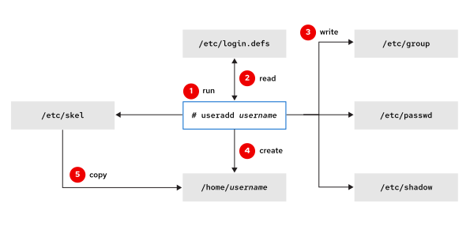

# Managing Local User Accounts

## Objectives

- Create, modify, and delete local user accounts.

## Managing Local Users from the Command Line

You can use command-line tools to manage local user accounts. This section reviews some important tools for creating and deleting user accounts, and for setting passwords for users.\
**Creating Users**\
The useradd username command creates a user account named username. This command completes the following tasks to set up and configure the new account:\
The useradd username command creates a user account named username. This command completes the following tasks to set up and configure the new account:\


|   | Run the useradd command as the superuser.                                                                                                                                    |
| - | ---------------------------------------------------------------------------------------------------------------------------------------------------------------------------- |
|   | The useradd command reads the configuration for user creation from the /etc/login.defs file.                                                                                 |
|   | The useradd command writes an entry in the /etc/group, /etc/passwd, and /etc/shadow files with the information that is assigned to the username user (user ID and group ID). |
|   | The useradd command creates the home directory of the username user in the /home/username path.                                                                              |
|   | The useradd command copies the user profile files in the /etc/skel directory to the username user's home directory (under /home/username).                                   |

At this point, a valid password is not set for the account, and the user cannot log in until a password is set.\
The useradd --help command displays the basic options to override the defaults. Usually, you can use the same options with the usermod command to modify an existing user.\
The useradd --help command displays the basic options to override the defaults. Usually, you can use the same options with the usermod command to modify an existing user.\
By default, the useradd command assigns new users the first free UID that is greater than or equal to 1000, unless you explicitly specify a UID by using the -u option.\
By default, the useradd command assigns new users the first free UID that is greater than or equal to 1000, unless you explicitly specify a UID by using the -u option.\
**Modifying Existing Users**\
The usermod --help command displays the options to modify an account. The following table shows some common options for managing user accounts.\
**Table 10.1. usermod Command Options to Modify Users**

| usermod option        | Usage                                                                                                                                                                         |
| --------------------- | ----------------------------------------------------------------------------------------------------------------------------------------------------------------------------- |
| -a, --append          | Use it with the -G option to add the supplementary groups to the user's current set of group memberships instead of replacing the set of supplementary groups with a new set. |
| -c, --comment COMMENT | Add the COMMENT text to the comment field.                                                                                                                                    |
| -d, --home HOME-DIR   | Specify a home directory for the user account.                                                                                                                                |
| -g, --gid GROUP       | Specify the primary group for the user account.                                                                                                                               |
| -G, --groups GROUPS   | Specify a comma-separated list of supplementary groups for the user account.                                                                                                  |
| -L, --lock            | Lock the user account.                                                                                                                                                        |
| -m, --move-home       | Move the user's home directory to a new location. You must use it with the -d option.                                                                                         |
| -s, --shell SHELL     | Specify a particular login shell for the user account.                                                                                                                        |
| -U, --unlock          | Unlock the user account.                                                                                                                                                      |

**Deleting Users**\
The userdel username command removes the username user from the /etc/passwd file, but leaves the user's home directory intact. The userdel -r username command removes the user from the /etc/passwd file and deletes the user's home directory.\
The userdel username command removes the username user from the /etc/passwd file, but leaves the user's home directory intact. The userdel -r username command removes the user from the /etc/passwd file and deletes the user's home directory.

## Warning

When you remove a user without specifying the userdel -r option, an unassigned UID now owns the user's files. If you create a user and that user is assigned the deleted user's UID, then the new account owns those files, which is a security risk. Typically, organization security policies disallow deleting user accounts, and instead lock them from being used, to avoid this scenario.\
The following example demonstrates how this scenario can lead to information leakage:

```
root@host:~# useradd user01
root@host:~# ls -l /home
drwx------.  4 user01     user01       93 May  9 17:40 user01
root@host:~#
```

```
userdel user01
```

```
root@host ~#
```

```
ls -l /home
```

```
drwx------.  4       1000       1000   93 May  9 17:40 user01
root@host:~#
```

```
useradd -u 1000 user02
```

```
root@host:~#
```

```
ls -l /home
```

```
drwx------.  4 user02     user02       93 May  9 17:40 user01
drwx------.  4 user02     user02       93 May  9 17:41 user02
```

Notice that the user02 user now owns all files that the user01 user previously owned. The root user can use the find / -nouser -o -nogroup command to find all unowned files and directories.\
**Setting Passwords**\
The passwd username command sets the initial password or changes the existing password for the username user.\
The passwd username command sets the initial password or changes the existing password for the username user.\
The root user can set a password to any value. If the password does not meet the minimum recommended criteria, then the terminal displays a message. You can retype the same password, and the passwd command updates it successfully.\
The root user can set a password to any value. If the password does not meet the minimum recommended criteria, then the terminal displays a message. You can retype the same password, and the passwd command updates it successfully.

```
root@host:~# passwd user01
New password:
```

```
redhat
```

```
BAD PASSWORD: The password is shorter than 8 characters
Retype new password: redhat
passwd: password updated successfully
root@host:~#
```

A regular user must choose a password at least eight characters long. Do not use a dictionary word, the username, or the previous password.\
**UID Ranges**\
Red Hat Enterprise Linux uses specific UID numbers and ranges of numbers for specific purposes.\
UID 0\
The superuser (root) account UID.\
The superuser (root) account UID.\
UID 1-200\
System account UIDs that are statically assigned to system processes.\
UID 201-999\
UIDs that are assigned to system processes that do not own files on this system. Software that requires an unprivileged UID is dynamically assigned a UID from this available pool.\
UID 1000+\
The UID range to assign to regular, unprivileged users.

## Note

You can change the default UID ranges for the useradd command in the /etc/login.defs file.

## References

useradd(8), usermod(8), userdel(8), login.defs(5), passwd(1), passwd(5), shadow(5), and group(5) man pages
