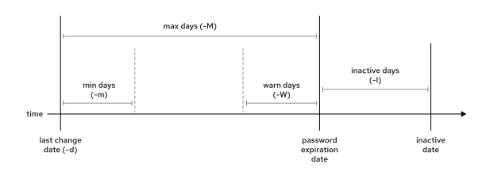

# Managing User Passwords

## Objectives

- Set a password management policy for users, and manually lock and unlock user accounts.

## Shadow Passwords and Password Policy

Originally, encrypted passwords were stored in the world-readable /etc/passwd file. These passwords were considered adequate until dictionary attacks on encrypted passwords became common. The cryptographically hashed passwords were moved to the /etc/shadow file, which only the root user can read.\
Like the /etc/passwd file, each user has an entry in the /etc/shadow file. An example entry from the /etc/shadow file has nine colon-separated fields:\
Like the /etc/passwd file, each user has an entry in the /etc/shadow file. An example entry from the /etc/shadow file has nine colon-separated fields:

```
root@host:~# cat /etc/shadow
...output omitted...
user03:$y$j9T$qybndwEWzHhr0uTGAwO4Q0$OuNgGC5Mx2RrCO4JOXtR2VJfTA8dLPxa7NV1tvhziHC:20222:0:99999:7:2:20282::
```

Each field of the entry is separated by a colon:

- user03 : Name of the user account.
- $y$j… .ziHC : The cryptographically hashed password of the user.
- 20222 : The days from the epoch when the password was last changed, where the epoch is 1970-01-01 in the UTC time zone.
- 0 : The minimum days since the last password change before the user can change it again.
- 99999 : The maximum days without a password change before the password expires. An empty field means that the password never expires.
- 7 : The number of days in advance to warn the user that their password will expire.
- 2 : The number of days without activity, starting with the day that the password expired, before the account is automatically locked.
- 20282 : The day when the account expires in days since the epoch. An empty field means that the account never expires.
- The last field is typically empty and is reserved for future use.\
  **Format of a Cryptographically Hashed Password**\
  The cryptographically hashed password field stores three key pieces of information: the hashing algorithm in use, the salt, and the cryptographical hash. Salt adds random data to the password, to create a unique hash to strengthen the cryptographically hashed password. Each piece of information is delimited by the dollar sign ($).

```
$y$j9T$qybndwEWzHhr0uTGAwO4Q0$OuNgGC5Mx2RrCO4JOXtR2VJfTA8dLPxa7NV1tvhziHC
```

- y : The hashing algorithm in use for this password. A y indicates a yescrypt hash; a 6 indicates a SHA-512 hash; and a 5 indicates SHA-256. The format of the rest of the password depends on the algorithm.
- j9T : Parameters that tune the behavior of how yescrypt hashes. These options are standardized by the tools that set passwords to ensure secure tuning. Other algorithms might not have this field.
- qybndwEWzHhr0uTGAwO4Q0 : The salt in use to cryptographically hash the password; it is originally chosen at random.
- OuNgGC5Mx2RrCO4JOXtR2VJfTA8dLPxa7NV1tvhziHC : The cryptographic hash of the user's password. This segment is the result of combining the salt and the plain text password, and then using the cryptographic hashing algorithm to generate the password hash.\
  The primary reason to combine a salt with the password is to defend against attacks that use precomputed lists of password hashes. Adding salts expands the number of possible hashes that must be checked for each word that could be a possible password, which makes it much more difficult to use a precomputed list due to its size. If an attacker obtains a copy of an /etc/shadow file that uses salts, then they need to guess passwords with brute force, which requires more time and effort.

## Note

The default hashing algorithm in RHEL 10 is yescrypt, a password-based key derivation function (KDF) and password hashing scheme based on NIST-approved cryptographic primitives, developed by Solar Designer.\
This default hashing algorithm is a change from RHEL 9, which used Ulrich Drepper's SHA-512 hashing algorithm by default. RHEL 10 still recognizes SHA-512 ($6$) password hashes that might be in the /etc/shadow file, but new and updated passwords are created by using yescrypt, which Red Hat considers to be more secure.\
For more information about local user password hashing algorithms in RHEL, refer to the crypt(5) man page and the article, [About Local User Password Hashing Algorithms in RHEL](https://access.redhat.com/articles/880733).\
**Password Verification**\
When a user tries to log in, the system looks up the entry for the user in the /etc/shadow file, and combines the salt for the user with the plain text typed password. The system then cryptographically hashes the combination of the salt and plain text password with the specified hashing algorithm. If the result matches the cryptographical hash, then the user typed the right password. If the result does not match the cryptographical hash, then the user typed the wrong password and the login attempt fails. This method enables the system to determine whether the user typed the correct password without storing that password in a usable form for logging in.\
When a user tries to log in, the system looks up the entry for the user in the /etc/shadow file, and combines the salt for the user with the plain text typed password. The system then cryptographically hashes the combination of the salt and plain text password with the specified hashing algorithm. If the result matches the cryptographical hash, then the user typed the right password. If the result does not match the cryptographical hash, then the user typed the wrong password and the login attempt fails. This method enables the system to determine whether the user typed the correct password without storing that password in a usable form for logging in.

## Configuring Password Aging

The following diagram shows the relevant password aging parameters, which can be adjusted by using the chage command to implement a password aging policy. Notice that the command name is chage, which stands for "change age". Do not confuse the command with the word "change".\
\
Figure 10.1: Password aging parameters\
The following example demonstrates using the chage command to change the password policy of the sysadmin05 user. The command defines a minimum age (-m) of 0 days, a maximum age (-M) of 90 days, a warning period (-W) of 7 days, and an inactivity period (-I) of 14 days.\
The following example demonstrates using the chage command to change the password policy of the sysadmin05 user. The command defines a minimum age (-m) of 0 days, a maximum age (-M) of 90 days, a warning period (-W) of 7 days, and an inactivity period (-I) of 14 days.

```
root@host:~# chage -m 0 -M 90 -W 7 -I 14 sysadmin05
```

Assume that you manage the user password policies on a Red Hat server. The cloudadmin10 user is new in the system, and you want to set a custom password aging policy. You want to set the account expiration to 30 days from today, so you use the following commands:

```
root@host:~# date +%F

2025-05-14
root@host:~#
```

```
date -d "+30 days" +%F
```

```

2025-06-13
root@host:~# chage -E $(date -d "+30 days" +%F) cloudadmin10

root@host:~#
```

```
chage -l cloudadmin10 | grep "Account expires"
```

```

Account expires						: Jun 13, 2025
```

|   | Use the date command to get the current date.                                                   |
| - | ----------------------------------------------------------------------------------------------- |
|   | Use the date command to get the date 30 days from now.                                          |
|   | Use the chage command -E option to change the expiration date for the cloudadmin10 user.        |
|   | Use the chage command -l option to display the password aging policy for the cloudadmin10 user. |

****Note****\
The date command can calculate a future date. The -u option reports the time in UTC.

```
user@host:~$ date -d "+45 days" -u
Sat Jun 28 03:46:10 UTC 2025
```

After a few days, the /var/log/secure log file shows some unexpected behavior from the cloudadmin10 user. The user tried to use the sudo command to interact with files that belong to other users. You suspect that the user might have left an ssh session open when working in another machine. You want the cloudadmin10 user to change the password on the next login, so you use the following command:

```
root@host:~# chage -d 0 cloudadmin10
```

The next time that the cloudadmin10 user logs in, the user is prompted to change the password.

## Adjusting Password Aging for New Users

To change the default password aging configuration system-wide, you can modify the /etc/login.defs file. This file contains several key parameters:

```
PASS_MAX_DAYS
```

Sets the maximum number of days a password is valid before a user is required to change it.

```
PASS_MIN_DAYS
```

Specifies the minumum number of days that must pass before a password can be changed.

```
PASS_WARN_AGE
```

Determines how many days in advance a user receives a warning about their password expiring.\
For new user accounts, the useradd command also pulls default values from the /etc/default/useradd file. This is where you can set the default inactivity period and account expiration date if you want these settings to apply automatically to all new users created with the useradd command.

```
[root@host ~]# cat /etc/default/useradd
...output omitted...
INACTIVE=21
EXPIRE=2025-12-31
...output omitted...
```

Any changes made to these default settings only affects new users created after the changes are saved. Existing users continue to be governed by the password aging policies that were in effect at the time their accounts were created. To adjust password aging settings for individual users, you must use the chage command.

## Restricting User Access

You can restrict a user's access to a Linux system by using the usermod command. For example, the usermod command -L option locks a user account by invalidating the user's password:

```
root@host:~# usermod -L sysadmin03
user01@host:~$
```

```
su - sysadmin03
```

```
Password:
```

```
redhat
```

```
su: Authentication failure
```

A crucial limitation of using only the -L option is that it does not affect SSH key-based authentication. If a valid SSH key is configured for the user, then the user can still log in remotely without entering a password. This limitation poses a potential security risk.\
A more comprehensive approach is to expire the account, which prevents all logins, including logins with SSH keys. The usermod command -e option sets an account's expiration date. The expiration date can be set by using an integer to specify the number of days since January 1, 1970, or by using the YYYY-MM-DD format.\
You can lock the account and set an expiration date by using a single usermod command with the appropriate options. In the following example, the usermod command locks and expires the cloudadmin10 user account on June 1, 2025.

```
root@host:~# usermod -L -e 2025-06-01 cloudadmin10
```

This method is highly recommended for deactivating the accounts of former employees.\
To restore a user's access, you can use the -U option to unlock their password. To remove the expiration date, use the -e option with a null value.\
The following example unlocks the password and removes the expiration date for the cloudadmin10 user:\
The following example unlocks the password and removes the expiration date for the cloudadmin10 user:

```
root@host:~# usermod -U -e '' cloudadmin10
```

**The nologin Shell**\
The nologin shell acts as a replacement shell for the user accounts that are not intended to log in interactively to the system. A good security practice is to disable an account from logging in to the system when the account does not require it. For example, a mail server might require an account to store mail and a password for the user to authenticate with a mail client to retrieve mail. That user does not need to log in directly to the system.\
The nologin shell acts as a replacement shell for the user accounts that are not intended to log in interactively to the system. A good security practice is to disable an account from logging in to the system when the account does not require it. For example, a mail server might require an account to store mail and a password for the user to authenticate with a mail client to retrieve mail. That user does not need to log in directly to the system.\
A common solution to this situation is to set the user's login shell to /sbin/nologin. If the user attempts to log in to the system directly, then the nologin shell closes the connection.

```
root@host:~# usermod -s /sbin/nologin newapp
root@host:~# su - newapp
Last login: Wed May 14 03:49:38 UTC 2025 on pts/0
This account is currently not available.
```

## Important

The nologin shell prevents interactive use of the system, but does not prevent all access. Users might be able to authenticate and upload or retrieve files through applications such as web applications, file transfer programs, or mail readers if they use the user's password for authentication and do not require a shell.
