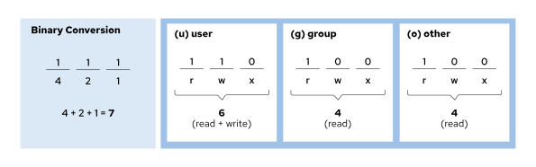

## Changing File and Directory Permissions

In Linux, you can configure permissions on files and directories to define specific access for different sets of users. The main utility for configuring these permissions is the chmod command. The chmod command stands for "change mode", where mode refers to a file's permissions. The following list shows some key characteristics of the chmod command:\
**Changing Permissions with the Symbolic Method**\
The symbolic method of changing file permissions uses letters to represent the user categories and permissions, and symbols to modify the permission settings.\
Use the chmod command to modify file and directory permissions. The general syntax is as follows:

```
user@host:~$ chmod Who/What/Which file|directory
```

Who is the class of user, as in the following table. If you do not provide a class of user, then the chmod command uses the all group as the default.

| Who | User class | Description                                                       |
| --- | ---------- | ----------------------------------------------------------------- |
| u   | user       | The file owner.                                                   |
| g   | group      | Member of the file's group.                                       |
| o   | other      | Users who are not the file owner nor members of the file's group. |
| a   | all        | All three previous groups.                                        |

What is the operator that modifies the permissions, as in the following table.

| What | Operation   | Description                                        |
| ---- | ----------- | -------------------------------------------------- |
| +    | add         | Adds the permissions to the file.                  |
| -    | remove      | Removes the permissions to the file.               |
| =    | set exactly | Sets exactly the provided permissions to the file. |

Which is the mode, and specifies which permissions to set for the files or directories, as in the following table.

| Which | Mode            | Description                                                                                                                  |
| ----- | --------------- | ---------------------------------------------------------------------------------------------------------------------------- |
| r     | read            | Read access to the file. Listing access to the directory.                                                                    |
| w     | write           | Write permissions to the file or directory.                                                                                  |
| x     | execute         | Execute permissions to the file. Allows entering the directory, and accessing files and subdirectories inside the directory. |
| X     | special execute | Execute permissions to a directory, or execute permissions to a file if at least one of the execute bits is set.             |

The symbolic method uses letters to represent the permission groups: u for user, g for group, o for other, and a for all.\
With the symbolic method, you do not need to set a complete new group of permissions. Instead, you can change one or more of the existing permissions. Use the plus (+) or the minus (-) characters to add or remove permissions, respectively, or use the equal sign (=) to replace the entire set for a group of permissions.\
A single letter represents the permissions themselves: r for read, w for write, and x for execute. You can use an uppercase X as the permission flag to add execute permissions only if the file is a directory or if execute is already set for user, group, or other.\
The following example shows using the symbolic method to remove read and write permission for group and other on the document.pdf file:

```
user@host:~$ chmod go-rw document.pdf
```

This example shows adding execute permission for everyone on the myscript.sh file:

```
user@host:~$ chmod a+x myscript.sh
```

You can use the chmod command -R option to recursively set permissions on the files in an entire directory tree. For example, the next command recursively adds read, write, and execute permissions for the members of the group that own the myfolder directory and the files and directories inside it.

```
user@host:~$ chmod -R g+rwx /home/user/myfolder
```

You can also use the chmod command -R option with the -X option to set permissions symbolically. With the chmod command X option, you can set the execute (search) permission on directories so that their contents can be accessed, without changing permissions on most files. However, be cautious with the X option, because if any execute permission is set on a file, then the X option sets the specified execute permission on that file as well.\
For example, the following command recursively sets group read and write access to the demodir directory and its contents, adding group execute only where execute is already set for user, group, or others.\
For example, the following command recursively sets group read and write access to the demodir directory and its contents, adding group execute only where execute is already set for user, group, or others.

```
root@host:# chmod -R g+rwX demodir
```

**Changing Permissions with the Octal Method**\
You can use the chmod command to change file permissions with the octal method instead of the symbolic method. In the following example, the number sign (#) represents three digits:\
You can use the chmod command to change file permissions with the octal method instead of the symbolic method. In the following example, the number sign (#) represents three digits:

```
user@host:~$ chmod ### file|directory
```

With the octal method, you can represent permissions as a 3-digit (or 4-digit, when setting advanced permissions) octal number. A single octal digit can represent any single value from 0-7.\
In the 3-digit octal representation of permissions, each digit stands for one access level, from left to right: user, group, and other. To determine each digit:

- Start with 0.
- To add read permissions for this access level, add 4.
- To add write permissions, add 2.
- To add execute permissions, add 1.\
  The following diagram illustrates how systems interpret the 644 octal permission value.\
  \
  Figure 11.1: Visual representation of the octal method\
  Experienced administrators often use the octal method to implement permissions on single or matching files, and provide full permission control.\
  The following example shows using the octal method to set read and write permissions for user, and read permission for group and other, on the sample.txt file:

```
user@host:~$ chmod 644 sample.txt
```

This example shows setting read, write, and execute permissions for user, read and execute permissions for group, and no permission for other on the sampledir directory:

```
user@host:~$ chmod 750 sampledir
```
