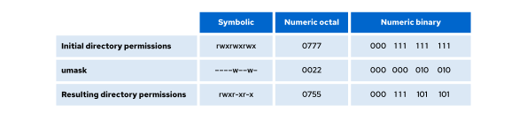

# Managing Default Permissions and Special Permissions

## Objectives

- Control the default permissions of user-created files, and explain special permissions on files.

## Special Permissions

Special permissions are a fourth type of permission, in addition to user, group, and other. As the name implies, special permissions provide additional access-related features beyond what the basic permission types allow. The setuid, setgid, and sticky special permissions provide additional control over file and directory behavior. This section describes the impact of special permissions, which are summarized in the following table.\
**Table 11.2. Effects of Special Permissions on Files and Directories**

| Permission   | Effect on files                                                                  | Effect on directories                                                                                 |
| ------------ | -------------------------------------------------------------------------------- | ----------------------------------------------------------------------------------------------------- |
| u+s (suid)   | File executes as the user that owns the file, not as the user that ran the file. | No effect.                                                                                            |
| g+s (sgid)   | File executes as the group that owns the file.                                   | Files that are created in the directory have a group owner to match the group owner of the directory. |
| o+t (sticky) | No effect.                                                                       | Users with write access to the directory cannot delete or rename files that they do not own.          |

The setuid permission on an executable file means that commands run as the user that owns that file, rather than as the user that ran the command. One example is the passwd command:

```
user@host:~$ ls -l /usr/bin/passwd
-rw
```

```
sr-xr-x. 1 root root 91584 Nov  4  2024 /usr/bin/passwd
```

In a long listing, you can identify the setuid permissions by a lowercase s character in the place where you would typically expect the x character (owner execute permissions). If the owner does not have execute permissions, then this character is replaced by an uppercase S character.\
The setgid special permission on a directory means that created files in the directory inherit their group ownership from the directory, rather than inheriting group ownership from the creating user. This feature is commonly used on collaborative directories to automatically change a file from the default private group to the shared group, or in cases where a specific group should always own files in a directory. An example of this behavior is the /run/log/journal directory:\
The setgid special permission on a directory means that created files in the directory inherit their group ownership from the directory, rather than inheriting group ownership from the creating user. This feature is commonly used on collaborative directories to automatically change a file from the default private group to the shared group, or in cases where a specific group should always own files in a directory. An example of this behavior is the /run/log/journal directory:

```
user@host:~$ ls -ld /run/log/journal
drwxr-
```

```
sr-x+ 4 root systemd-journal 80 May 29 16:55 /run/log/journal
```

If setgid is set on an executable file, then commands run as the group that owns that file, rather than as the primary group of the user who ran the command. This behavior is similar to how setuid works.\
One example is the plocate command, which is a modern replacement for locate. The setgid permission is set on the /usr/bin/plocate binary, as shown in the following example:

```
user@host:~$ ls -ld /usr/bin/plocate
-rwxr-
```

```
sr-x. 1 root plocate 318224 Feb 14 00:00 /usr/bin/plocate
```

In a long listing, you can identify the setgid permissions by a lowercase s character in the place where you would typically expect the x character (group execute permissions). If the group does not have execute permissions, then this character is replaced by an uppercase S character.\
Finally, the sticky bit for a directory sets a special restriction on the deletion of files. Only the owner of the file (and the root user) can delete files in the directory. An example is the /tmp directory:

```
user@host:~$ ls -ld /tmp
drwxrwxrwt. 11 root root 4096 May 29 19:57 /tmp
```

In a long listing, you can identify the sticky permissions by a lowercase t character in the place where you would typically expect the x character (other execute permissions). If other does not have execute permissions, then this character is replaced by an uppercase T character.\
**Setting Special Permissions**\
You can set special permissions by using symbolic notation or as a fourth digit in octal mode.\
**Table 11.3. Setting Special Permissions**

| Permission | Octal Notation | Symbolic Notation |
| ---------- | -------------- | ----------------- |
| setuid     | 4              | u+s               |
| setgid     | 2              | g+s               |
| sticky     | 1              | o+t               |

**Examples of Special Permissions**\
Add the setgid bit on the example directory by using the symbolic method:\
Add the setgid bit on the example directory by using the symbolic method:

```
user@host:~$ chmod g+s example
```

Remove the sticky bit from the example directory by using the symbolic method:

```
user@host:~$ chmod o-t example
```

Set the setgid bit and add read, write, and execute permissions for user and group, with no access for others, on the example directory by using the octal method:

```
user@host:~$ chmod 2770 example
```

Remove the setgid bit and add read, write, and execute permissions for user and group, with no access for others, on the example directory by using the octal method. Note that you need to add an extra 0 at the beginning of the permissions value when removing special permissions by using the octal method:

```
user@host:~$ chmod 00770 example
```

## Default Permissions

In addition to setting special permissions, you can also manage the default permissions of new files and directories by using the umask setting. The umask setting alters the permission settings for newly created files or directories.\
New files are assigned initial permissions based on two factors:

- Whether you are creating a regular file or a directory.
- The current umask (user file-creation mask).\
  **Table 11.4. Initial Permissions Before umask**

| Type      | Initial Octal Method | Initial Symbolic Method |
| --------- | -------------------- | ----------------------- |
| File      | 0666                 | rw-rw-rw-               |
| Directory | 0777                 | rwxrwxrwx               |

You must always explicitly add execute permission to a regular file. This step makes it harder for an attacker to compromise a system, create a malicious file, and run it.\
**Effects of umask on Files and Directories**\
**Effects of umask on Files and Directories**\
The umask is a permission filter that is applied to the default permissions when a file or directory is created. Each bit set in the umask removes a corresponding permission from the final permissions of new files or directories.\
**Table 11.5. umask Examples**\
**Table 11.5. umask Examples**

| umask | Effect on Files | Effect on Directories |
| ----- | --------------- | --------------------- |
| 0022  | rw-r— r--       | rwxr-xr-x             |
| 0027  | rw-r-----       | rwxr-x---             |
| 0002  | rw-rw-r--       | rwxrwxr-x             |

In RHEL 9 and later versions, the default umask for all regular users is 0022. The umask command without arguments displays the current value of the shell's umask:

```
user@host:~$ umask
0022
```

You can temporarily set a new umask for the current shell by running the umask command with a single octal argument:

```
user@host:~$ umask 0027
```

You can omit any leading zeros in the umask. For example, umask 077 is the same as umask 0077.\
The system's default umask values for Bash shell users are defined in the /etc/login.defs file, and in the /etc/bashrc file. Users can override the system defaults in the .bash_profile or .bashrc files in their home directories.\
The system's default umask values for Bash shell users are defined in the /etc/login.defs file, and in the /etc/bashrc file. Users can override the system defaults in the .bash_profile or .bashrc files in their home directories.

## Important

In Red Hat Enterprise Linux 8 and earlier, the default umask is 0002 for regular users who have a UID of 200 or greater and whose primary group name matches their username. The default umask for other users, including the root user, is 0022.\
Red Hat Enterprise Linux 9 and later versions consistently apply a default umask of 0022 for all users, in both login and non-login shells. RHEL 9 and later versions no longer make exceptions to the default umask setting based on user ID or matching group names, which improves consistency and simplifies security expectations.\
**Examples of umask Settings**\
**Examples of umask Settings**\
In the following example, the system grants read and write access to the file owner, and read-only access to the group and others, reflecting a typical umask 0022 setup that restricts write access for nonowners.

```
user@host:~$ umask
0022
user@host:~$ touch default.txt
user@host:~$ ls -l default.txt
-rw-r--r--. 1 user user 0 May 29 22:11 default.txt
```

\
Figure 11.2: Example of umask calculation on a file\
In the following example, the system grants full access to the directory owner, and read and execute access to the group and others, reflecting a typical umask 0022 setup that restricts write access for nonowners.

```
user@host:~$ umask
0022
user@host:~$ mkdir default
user@host:~$
```

```
ls -ld default
```

```
drwxr-xr-x. 2 user user 6 May 29 22:14 default
```

\
Figure 11.3: Example of umask calculation on a directory\
In the following example, the umask value is set to 0, which changes the file permissions for others from read to read and write. The directory permissions for others change from read and execute to read, write, and execute.

```
user@host:~$ umask 0
user@host:~$
```

```
touch zero.txt
```

```
user@host:~$
```

```
ls -l zero.txt
```

```
-rw-rw-rw-. 1 user user 0 May 29 22:17 zero.txt
user@host:~$
```

```
mkdir zero
```

```
user@host:~$
```

```
ls -ld zero
```

```
drwxrwxrwx. 2 user user 6 May 29 22:17 zero
```

A umask of 027 ensures that new files have read and write permissions for user and read permission for group. New directories have read and execute permissions for group and no permissions for others.

```
user@host:~$ umask 027
user@host:~$ touch two-seven.txt
user@host:~$
```

```
ls -l two-seven.txt
```

```
-rw-r-----. 1 user user 0 May 29 22:19 two-seven.txt
user@host:~$ mkdir two-seven
user@host:~$ ls -ld two-seven
drwxr-x---. 2 user user 6 May 29 22:20 two-seven
```

## References

bash(1), ls(1), chmod(1), and umask(1) man pages
