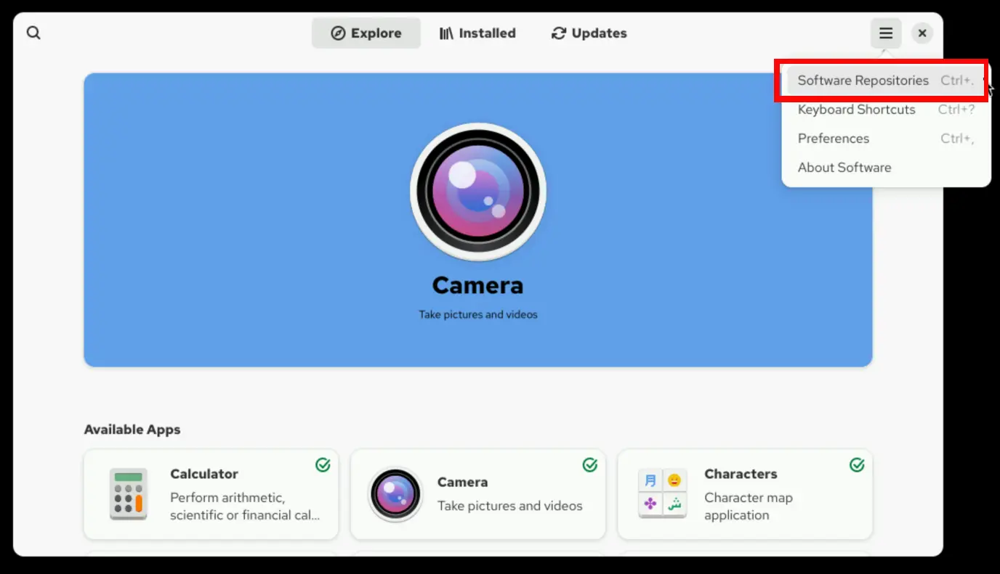
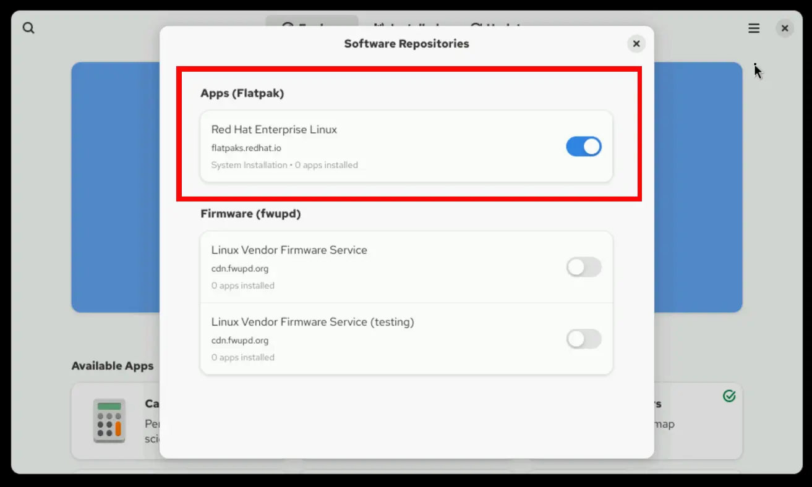

## Chapter 13. Installing and Updating Applications by Using Flatpak

**Abstract**

| Goal                                                     | Install, upgrade, and use desktop software from the Red Hat Ecosystem Catalog by using Flatpak. |
| -------------------------------------------------------- | ----------------------------------------------------------------------------------------------- |
| Sections                                                 | Configuring Flatpak for Application Installation (and Guided Exercise)                          |
| Managing Applications from Flatpak (and Guided Exercise) |                                                                                                 |
| Install and Update Applications by Using Flatpak (Quiz)  |                                                                                                 |

****Configuring Flatpak for Application Installation****

## Objectives

- Install and configure Flatpak tools and remote repositories, and explain the basic operation of Flatpak.

## Introduction to Flatpak

Although the model for packaging applications in Linux has evolved significantly over the years, it still presents challenges:

- Developers must tailor their applications for a specific Linux operating system and version. As a result, developers spend more time and effort to package applications for each distribution.
- Users might run into technical difficulties in deploying an application that is not packaged specifically for their preferred distribution.
- Development and maintenance can be complex because dependencies for an application can differ between the production environment and the development platform. Flatpak addresses these challenges by applying server-side container concepts and Linux kernel technology to the desktop environment. When a desktop application is packaged as a Flatpak image, the application can run reliably on most Linux distributions and versions. Applications do not behave incorrectly or crash due to discrepancies in dependencies. With Flatpak, each application is built and run in an isolated environment that is called a sandbox. By default, the application can access only the contents of its sandbox. The application's access to files, the network, graphics sockets, the system bus, and devices must be explicitly granted. The application's access to other resources, such as other processes, is not possible by design. **Flatpak Runtimes** In a Flatpak sandbox, the application uses its own libraries, not the
  operating system's libraries. However, maintaining a separate copy of all libraries for each desktop application consumes too much space, so many applications can share a Flatpak runtime. A runtime is a file-system image with system-level libraries and other files. A system can provide multiple runtimes that different applications can use. Another significant benefit of runtime separation is with managing security updates. When a security vulnerability is discovered in a system library, developers must update only the runtime without having to rebuild each application. A runtime might not provide every library that an application requires. Therefore, the application can also bundle its own libraries.

## Managing Flatpak Remote Repositories

Flatpak applications and runtimes are distributed in repositories that are named remotes. Red Hat packages several open source applications and distributes them in a remote repository. Although unsupported, third-party remote repositories are also available; they complement the Red Hat catalog and offer a broad selection of applications. The largest and best-known third-party repository is Flathub, which is available at [https://flathub.org](https://flathub.org/). The Fedora Project also has its own Flatpak remote repository.

## Important

Red Hat does not support applications from third-party remote repositories. You can use either the flatpak command or the GNOME Software graphical tool to manage packages. With either tool, you can configure multiple remote repositories, and simplify Flatpak management though unified interfaces. **Initial Flatpak Setup** Flatpak is installed by default in Red Hat Enterprise Linux 10 along with the gnome-software RPM package. If Flatpak is not installed, then you can install it by using the dnf command: If Flatpak is not installed, then you can install it by using the dnf command:

```
root@host:~# dnf install flatpak
```

To display the version of Flatpak that is installed on your system, use the flatpak --version command:

```
user@host:~$ flatpak --version
Flatpak 1.16.0
```

The default remote repository for RHEL 10 is the Flatpak object repository in the Red Hat Ecosystem Catalog. To access this repository, you must provide your Red Hat Customer Portal account credentials or your registry service account tokens. Log in to Red Hat Container Catalog by using the podman login command:

```
user@host:~$ podman login registry.redhat.io
Username: provide-username
Password:
```

```
provide-password
```

```
Login Succeeded!
```

By default, the login credentials expire after the current session. However, you can permanently save the credentials for the current user:

```
user@host:~$ cp $XDG_RUNTIME_DIR/containers/auth.json \
$HOME/.config/flatpak/oci-auth.json
```

```
```

You can also save the credentials system-wide.

```
root@host:~# cp $XDG_RUNTIME_DIR/containers/auth.json \
/etc/flatpak/oci-auth.json
```

If you want regular users to access the remote repository with the same credentials, then you must change the file permissions on the authentication token:

```
root@host:~# chmod 644 /etc/flatpak/oci-auth.json
```

To list all the remote repositories that are configured on your system, use the flatpak remotes command:

```
user@host:~$ flatpak remotes
Name Options
rhel system,oci,no-gpg-verify
```

To show the details for the remote repositories, add the -d parameter to the flatpak remotes command. Details include the repository name, its unique identifier, and other properties such as the repository URL and configured options.

```
user@host:~$ flatpak remotes -d
Name Title      URL              Collection ID     ... Priority Options   ...
rhel Red Hat... oci+https://.../ com.redhat.Stable -   1        system... ...
```

To list the applications that are available in a remote repository, use the flatpak remote-ls command. To ignore runtimes and list only the applications, add the --app option:

```
user@host:~$ flatpak remote-ls --app
Name           Application ID             Version     Branch   Arch
Thunderbird    org.mozilla.Thunderbird                stable   x86_64
Firefox        org.mozilla.firefox        128.11.0    stable   x86_64
```

**Adding a Flatpak Remote Repository** From the command line, you can configure additional remote repositories as installation sources and expand the catalog of Flatpak applications. For example, the Fedora Project hosts a remote registry that other distributions can also use because of Flatpak's universal design. To add this remote repository, run the flatpak remote-add command. The first argument defines the name for the local copy of the remote repository. The second argument defines the remote repository's location, which can point either to the actual location or to the definition file with the .flatpakrepo extension. The --if-not-exists option avoids overwriting the remote repository if it exists in the system: For example, the Fedora Project hosts a remote registry that other distributions can also use because of Flatpak's universal design. To add this remote repository, run the flatpak remote-add command. The first argument defines the name for the local copy of the remote
repository. The second argument defines the remote repository's location, which can point either to the actual location or to the definition file with the .flatpakrepo extension. The --if-not-exists option avoids overwriting the remote repository if it exists in the system:

```
user@host:~$ flatpak remote-add --if-not-exists fedora \
oci+https://registry.fedoraproject.org
```

To confirm that the Fedora repository is added as an installation source, use the flatpak remotes command to list all the remote repositories that are configured on your system:

```
user@host:~$ flatpak remotes
Name   Options
fedora system,oci
rhel   system,oci,no-gpg-verify
```

By default, the flatpak command applies operations to the whole system, as if the --system option was used explicitly. In the previous example, the newly added remote repository is available to all users on the system to search and install packages from. However, you can also configure a repository in user installation mode by adding the --user option. In that mode, the Flatpak object is available only to the user that ran the command. However, you can also configure a repository in user installation mode by adding the --user option. In that mode, the Flatpak object is available only to the user that ran the command. The following example shows configuring the Flathub repository in user mode:

```
user@host:~$ flatpak remote-add --if-not-exists --user \
flathub https://dl.flathub.org/repo/flathub.flatpakrepo
```

```
```

When multiple repositories are enabled, the flatpak remotes command can help to identify which repositories are available system-wide and which repositories are for the current user only. List the remote repositories that are available to all users:

```
user@host:~$ flatpak remotes --system
Name   Options
fedora oci
rhel   oci,no-gpg-verify
```

List the remote repositories that are available to the current user:

```
user@host:~$ flatpak remotes --user
Name    Options
flathub
```

After adding a remote repository, you can list the repository's contents by using the flatpak remote-ls command:

```
user@host:~$ flatpak remote-ls fedora --app
Name                      Application ID                 Version   Branch
Dialect                   app.drey.Dialect               2.4.2     stable
Multiplication Puzzle     app.drey.MultiplicationPuzzle  14.0      stable
pw3270                    br.app.pw3270.terminal         5.3       stable
Dconf Editor              ca.desrt.dconf-editor          45.0.1    stable
AbiWord                   com.abisource.AbiWord          3.0.5     stable
ConvertAll                com.bellz.ConvertAll           0.8.0     stable
...output omitted...
```

**Removing a Flatpak Remote Repository** To remove a Flatpak remote repository, use the flatpak remote-delete command. Before a remote repository is deleted, all software that is installed from that repository must be uninstalled. The command prompts you to confirm the removal of all associated references (applications and runtimes) before continuing.

```
user@host:~$ flatpak remote-delete fedora
The following refs are installed from remote 'fedora':

   1) runtime/org.fedoraproject.Platform.GL.default/x86_64/f41
   2) runtime/org.fedoraproject.Platform.Locale/x86_64/f41
   3) app/org.filezillaproject.Filezilla/x86_64/stable
   4) runtime/org.fedoraproject.Platform/x86_64/f41

Remove them? [y/n]:
```

```
y
```

```
Uninstalling runtime/org.fedoraproject.Platform.GL.default/x86_64/f41
Uninstalling app/org.filezillaproject.Filezilla/x86_64/stable
Uninstalling runtime/org.fedoraproject.Platform/x86_64/f41
Uninstalling runtime/org.fedoraproject.Platform.Locale/x86_64/f41
```

Instead of permanently deleting a repository and uninstalling all software that was sourced from it, you can disable the repository. Disabling a repository does not require removing previously installed Flatpaks. To disable a repository, use the flatpak remote-modify command.

```
user@host:~$ flatpak remote-modify --disable fedora
```

You can also re-enable the repository later if, for example, you must update one of the packages.

```
user@host:~$ flatpak remote-modify --enable fedora
```

## Managing Flatpak with the GNOME Software Graphical Tool

You can also manage the configured remote repositories with the graphical desktop tool. From the Gnome graphical desktop environment, click the Red Hat logo in the upper-left corner and then select Software from the dashboard, or use the Show Applications button to open the application. Click the Main Menu that appears as three lines in the upper-right corner of the window, and select Software Repositories.  Figure 13.1: Software main menu In the Software Repositories pop-up window, Flatpak applications are listed in the Apps (Flatpak) section. From this window, you can enable or disable the configured remote repositories.  Figure 13.2: Software repositories
