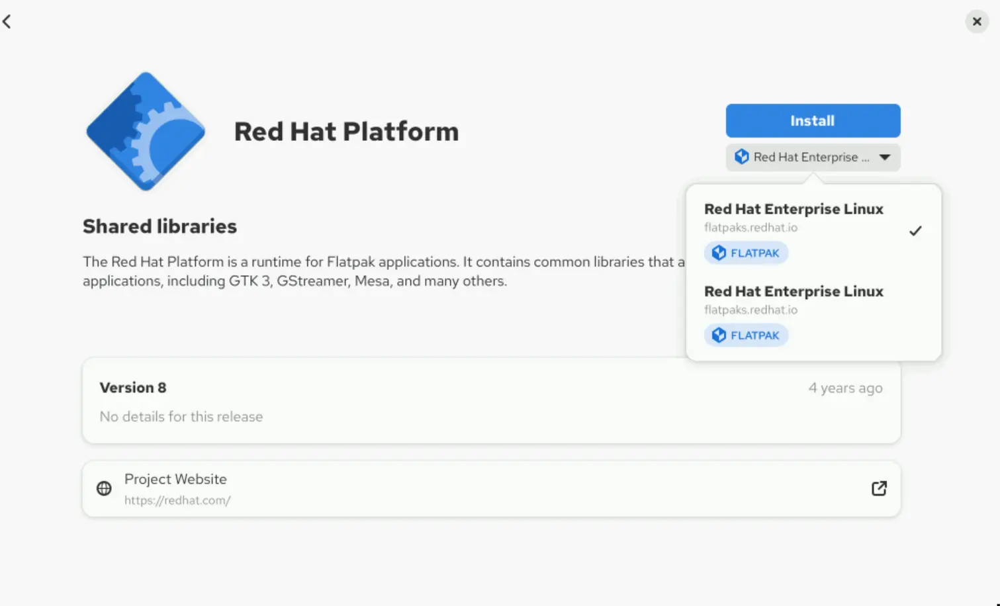

# Managing Applications from Flatpak

## Objectives

- Use Flatpak to list, search, install, update, remove, and get metadata information of applications.

## Managing Applications with the Flatpak CLI

By using Flatpak CLI commands, you can list, search, install, update, remove, and get metadata information for Flatpak applications and their runtime dependencies. You can use content from the repository from Red Hat and from third-party remote repositories. Red Hat does not support applications or runtimes from third-party remote repositories. **Flatpak Identifiers** Flatpak applications and runtimes use unique identifiers that follow the domain.organization.App format. This three-part identifier enables a company, developer, or organization to publish many applications with a shared prefix, such as com.company. The last segment (.App) identifies the application's name. You can use either the full or short object identifier for Flatpak operations: com.company.App or App. Flatpak applications and runtimes use unique identifiers that follow the domain.organization.App format. This three-part identifier enables a company, developer, or organization to publish many applications with a
shared prefix, such as com.company. The last segment (.App) identifies the application's name. You can use either the full or short object identifier for Flatpak operations: com.company.App or App. In some scenarios, you must specify the CPU architecture or version, such as stable or beta. You can request these additional specifications by using an object's identifier triple. The format of an identifier triple is ID/architecture/branch, such as org.organization.App/x86_64/stable. In Flatpak, branch refers to different versions of the same object. In some scenarios, you must specify the CPU architecture or version, such as stable or beta. You can request these additional specifications by using an object's identifier triple. The format of an identifier triple is ID/architecture/branch, such as org.organization.App/x86_64/stable. In Flatpak, branch refers to different versions of the same object. You can leave blank some parts of the identifier triple to specify part of the object. For
example, org.organization.App/x86_64// specifies only the architecture, and org.organization.App//stable specifies only the branch. **Querying Remote Repositories for Available Objects** The flatpak search command lists matching applications and runtimes that are available in all the remote repositories that are enabled in the system. This command uses cached appstream metadata that is already downloaded from the remote repository. If the cached metadata is more than one day old, then the metadata is updated automatically when the command is executed. The command uses a keyword to find a match in any of the metadata attributes that the application's XML file defines:

- Application or runtime name
- Description
- Application identifier
- Keyword that the developer defines The keyword is case-insensitive, and returns information for applications and runtimes that match the query. The following example shows a search that uses the thunderbird keyword to find applications in Flatpak remote repositories:

```
user@host:~$ flatpak -v search thunderbird

F: No installations directory in /etc/flatpak/installations.d. Skipping
F: Opening system flatpak installation at path /var/lib/flatpak

F: Opening user flatpak installation at path /home/user/.local/share/flatpak
F: fedora:x86_64 appstream age 491 is less than ttl 86400
F: rhel:x86_64 appstream age 1136 is less than ttl 86400
```

```
```

```

F: Opening system flatpak installation at path /var/lib/flatpak
```

```
```

```

F: Opening user flatpak installation at path /home/user/.local/share/flatpak
```

```
```

```

Thunderbird     Thunderbird is a free and open source email, newsfeed, chat, and calendaring client     net.thunderbird.Thunderbird            stable   fedora
```

```
```

```

Thunderbird     Thunderbird is a free and open source email, newsfeed, chat, and calendaring client     org.mozilla.Thunderbird         stable fedora
```

|   | The Flatpak search is executed with the -v option for verbose output. This option is recommended for troubleshooting.                                                                                                                                                                                                                                  |
| - | ------------------------------------------------------------------------------------------------------------------------------------------------------------------------------------------------------------------------------------------------------------------------------------------------------------------------------------------------------ |
|   | Flatpak first verifies whether the cached appstream metadata is up-to-date, in both the system and user installation paths.                                                                                                                                                                                                                            |
|   | After verification, Flatpak detects that the cached metadata for the rhel remote repository is less than the upstream metadata. The age (1136) of the cached data is less than 86400 ttl (time to live), so the cache is considered to be up-to-date and the Flatpak will not download new metadata from the repository. This makes the search faster. |
|   | Flatpak starts its serach by looking into default directory /var/lib/flatpak where all the applications and runtimes are installed for all users.                                                                                                                                                                                                      |
|   | Flatpak checks the user's local installation directory for applications and runtimes in /home/user/.local/share/. In this /home/user/.local/share/ path, Flatpak installs software specifically for the current user.                                                                                                                                  |
|   | After all remote repositories are verified or updated, Flatpak displays the matched output in categorized columns.                                                                                                                                                                                                                                     |

**Installing Flatpak Objects from Remote Repositories** The flatpak install command installs the requested objects, including all dependencies. The flatpak install command installs the requested objects, including all dependencies.

```
user@host:~$ flatpak install thunderbird
Looking for matches…
Remotes found with refs similar to 'thunderbird':


   1) 'fedora' (system)
   2) 'rhel' (system)

Which do you want to use (0 to abort)? [0-2]:
```

```
2
```

```
Found ref 'app/org.mozilla.Thunderbird/x86_64/stable' in remote 'rhel' (system).
Use this ref? [Y/n]: y
Required runtime for org.mozilla.Thunderbird/x86_64/stable (runtime/com.redhat.Platform/x86_64/el10) found in remote rhel

Do you want to install it? [Y/n]: y

org.mozilla.Thunderbird permissions:
```

```
```

```

    ipc       network       pcsc                  pulseaudio
    x11       dri           file access [1]       dbus access [2]

    [1] home:ro, xdg-download, xdg-run/dconf,
        ~/.cache/thunderbird:create, ~/.config/dconf:ro,
        ~/.mozilla:create, ~/.thunderbird:create
    [2] ca.desrt.dconf, org.a11y.
```

```
, org.freedesktop.Notifications
```

```
ID                      Branch Op Remote Download
```

```
```

```

 1.     com.redhat.Platform     el10   i  rhel   < 395.1 MB
 2.     org.mozilla.Thunderbird stable i  rhel   < 147.7 MB

Proceed with these changes to the system installation? [Y/n]: *y
```

```
```

```
Installing 1/2… ████████████████████ 100%  21.5 MB/s  00:00
```

```
```

```

Installing 2/2… ████████████████████ 100%  22.1 MB/s  00:00

Installation complete.
```

|   | If you do not specify the remote repository to search and more than one repository is configured for the user who is executing the command, then Flatpak looks for all remote repositories with references that match the identifier in the operation. The identifier can be in full or short form (for example, org.mozilla.thunderbird or thunderbird). |
| - | --------------------------------------------------------------------------------------------------------------------------------------------------------------------------------------------------------------------------------------------------------------------------------------------------------------------------------------------------------- |
|   | Flatpak automatically resolves the required runtimes for the application and prompts for permission to install it. If another application requires the same runtime in the future, then it uses the previously downloaded object, which avoids duplication and saves bandwidth.                                                                           |
|   | Flatpak keeps all applications in isolated environments, which require permissions to access resources in the host system. The resources that must be accessed with specific permissions are detailed at this point in the installation process.                                                                                                          |
|   | Flatpak summarizes the operation, and enumerates the objects to be installed, with information about the full identifier, branch, remote repository, and estimated download size.                                                                                                                                                                         |
|   | After this step, the process continues without interruption until completion.                                                                                                                                                                                                                                                                             |

The following table shows some useful options for the flatpak install command:

| Option           | Description                                                                 |
| ---------------- | --------------------------------------------------------------------------- |
| --runtime        | Installs only runtimes                                                      |
| --app            | Installs only applications                                                  |
| --or-update      | Performs an update if the application or runtime is already installed       |
| --system         | Installs the application or runtime in the default system-wide installation |
| -u, --user       | Installs the application or runtime for the current user only               |
| -y, --assumeyes  | Automatically answers yes for all questions                                 |
| --no-deploy      | Downloads to local cache without installing                                 |
| --no-pull        | Installs from local cache only                                              |
| --noninteractive | Produces minimal output and assumes yes for all questions                   |

**Querying Flatpak Objects Locally** You can list all the installed Flatpak objects by using the flatpak list command. You can list all the installed Flatpak objects by using the flatpak list command.

```
user@host:~$ flatpak list
Name             Application ID          Version Branch Installation
Red Hat Platform com.redhat.Platform     10      el10   system
Thunderbird      org.mozilla.Thunderbird         stable system
```

The flatpak info command shows information about the installed object based on the object identifier.

```
user@host:~$ flatpak info org.mozilla.Thunderbird
          ID: org.mozilla.Thunderbird
         Ref: app/org.mozilla.Thunderbird/x86_64/stable
        Arch: x86_64
      Branch: stable
      Origin: rhel
  Collection:
Installation: system
   Installed: 324.3 MB
     Runtime: com.redhat.Platform/x86_64/el10
         Sdk: com.redhat.Sdk/x86_64/el10

      Commit: 3dd6...1ae3
     Subject: Export org.mozilla.Thunderbird
        Date: 2025-05-27 09:39:04 +0000
      Alt-id: 3a6f...8b6f
```

**Installing Flatpak Objects from Specific Branches** Several versions of a Flatpak object might be available in a remote repository. Those versions are identified as branches. Branches can be designated by version numbers, such as 1.1 and 1.2, or by terms that represent the application lifecycle, such as stable, beta, or nightly. Use the flatpak remote-info command to verify which branches are available for a specific object. If only one branch is available for the requested identifier, then the command shows the output immediately. If more than one branch exists for the requested identifier, then the command returns an error and prompts for more information. Use the flatpak remote-info command to verify which branches are available for a specific object. If only one branch is available for the requested identifier, then the command shows the output immediately. If more than one branch exists for the requested identifier, then the command returns an error and prompts for more
information.

```
user@host:~$ flatpak remote-info rhel com.redhat.Platform
error: Multiple branches available for com.redhat.Platform, you must specify one of: com.redhat.Platform/x86_64/el10, com.redhat.Platform/x86_64/el9, com.redhat.Platform/x86_64/el8
```

If you know which branch to point, then you can specify the object version by using its identifier triple.

```
user@host:~$ flatpak install com.redhat.Platform/x86_64/el8
...output omitted...
```

**Updating Flatpak Objects** Use the flatpak update command to upgrade all your installed objects to the latest version in their respective branches. This command updates all objects. To update a single object, add the object identifier as an argument. Use the flatpak update command to upgrade all your installed objects to the latest version in their respective branches. This command updates all objects. To update a single object, add the object identifier as an argument.

```
user@host:~$ flatpak update com.redhat.Platform
Looking for updates…

Nothing to do.
```

## Note

The flatpak update command checks for updates within the same branch from which the application was initially installed. If a later version exists in a different branch, then Flatpak does not recognize the update. This behavior is similar to branches in a Git repository: checking out a branch means that you work only on that branch. To prevent the unwanted upgrade of certain objects, use the flatpak mask command. To mask a single object, add the object identifier as an argument.

```
user@host:~$ flatpak mask com.redhat.Platform
```

To unmask an object, use the flatpak mask --remove command with the object identifier.

```
user@host:~$ flatpak mask --remove com.redhat.Platform
```

**Uninstalling Flatpak Objects** The flatpak uninstall command removes Flatpak objects from the system. If you intend to uninstall a runtime object, then you must ensure that no installed application uses the object as a dependency, or you must use the --force-remove option to ignore dependency resolution. When you uninstall an application, the application's data directory remains in the system, in the ~/.var/app directory. To avoid consuming storage space with stale data, you can use the --delete-data option.

```
user@host:~$ flatpak uninstall --delete-data thunderbird
Found installed ref 'app/org.mozilla.Thunderbird/x86_64/stable' (system). Is this correct? [Y/n]:
```

```
y
```

```
        ID                             Branch        Op
 1. [-] org.mozilla.Thunderbird        stable        r
Uninstalling…
Delete data for org.mozilla.Thunderbird? [y/n]: y
```

## Managing Flatpak Objects with the GNOME Software Graphical Tool

You can search for, install, uninstall, or update Flatpak applications by using the GNOME Software graphical tool. From the GNOME graphical desktop environment, click Activities, and then select Software from the dashboard or use the Show Applications button to find the tool. You can also use the gnome-software command to open the GNOME Software tool. GNOME Software integrates DNF and Flatpak packages seamlessly regardless of their different source repositories. You can browse through the recommended applications by category, remove installed components, or check for updates. You can search for specific applications by using the search bar in the upper-left corner. In the search bar, type the keyword to search and the GNOME Software tool returns all the results that match, including both DNF packages and Flatpak objects. After you select the intended object, the GNOME Software tool displays the details of the Flatpak component.
 Figure 13.3: Flatpak object details To install the object, select the intended branch (if more than one branch is available for the object), and click Install. The GNOME Software tool resolves all the dependencies automatically and does not seek further confirmation. To uninstall a Flatpak object, click Uninstall.

## References

flatpak-remote-ls(1), flatpak-search(1), flatpak-install(1),flatpak-list(1), flatpak-info(1), flatpak-remote-info(1), flatpak-update(1), flatpak-mask(1), and flatpak-uninstall(1) man pages [Using Flatpak](https://docs.flatpak.org/en/latest/using-flatpak.html)
