# Portfolio App - KMM

Portfolio App:
- Android (Jetpack Compose), iOS (SwiftUI)
- Kotlin Multiplatform Mobile (KMM)
- Portfolio(Flutter) webapp: https://mitulvaghamshi.github.io/

## Screenshot(Android)

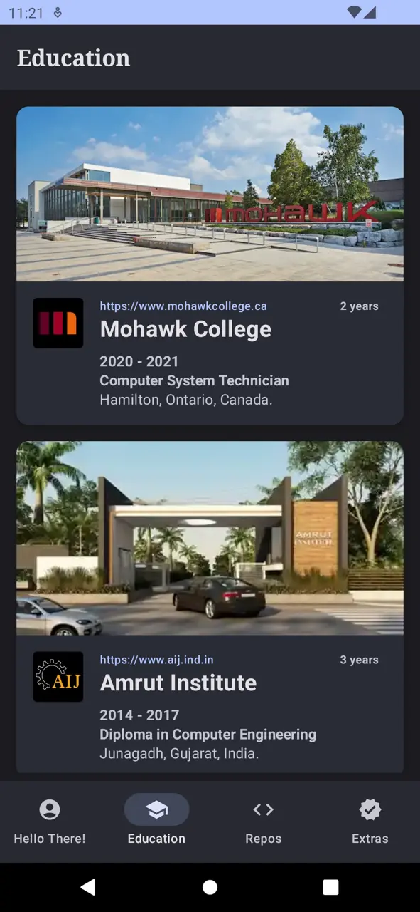
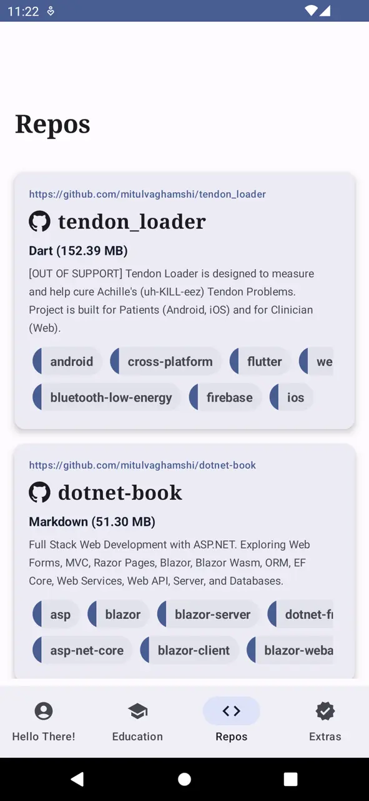
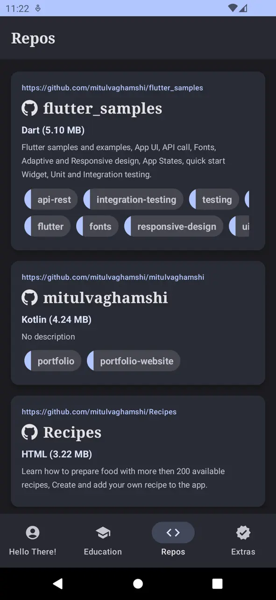
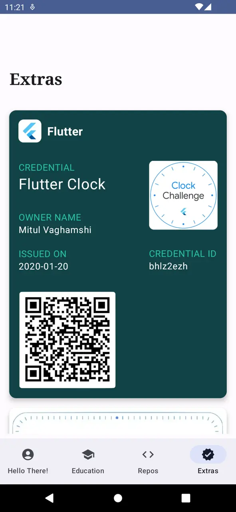
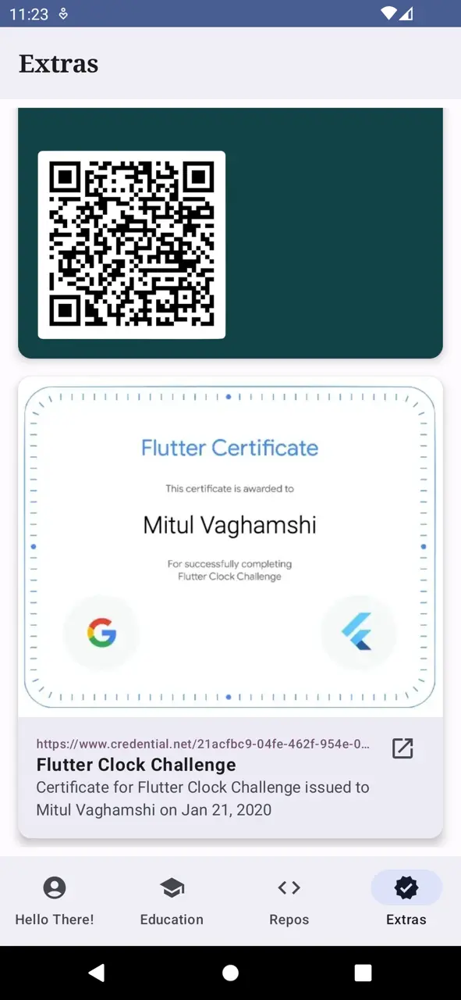

## Screenshot(iOS)

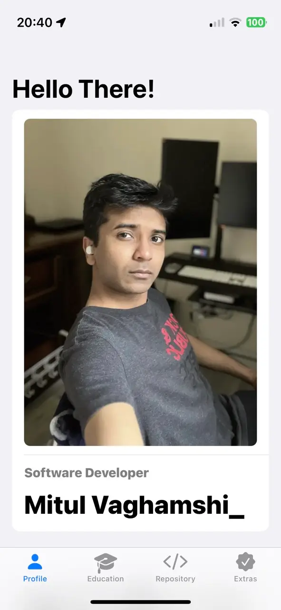 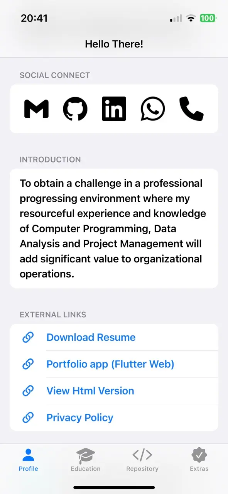
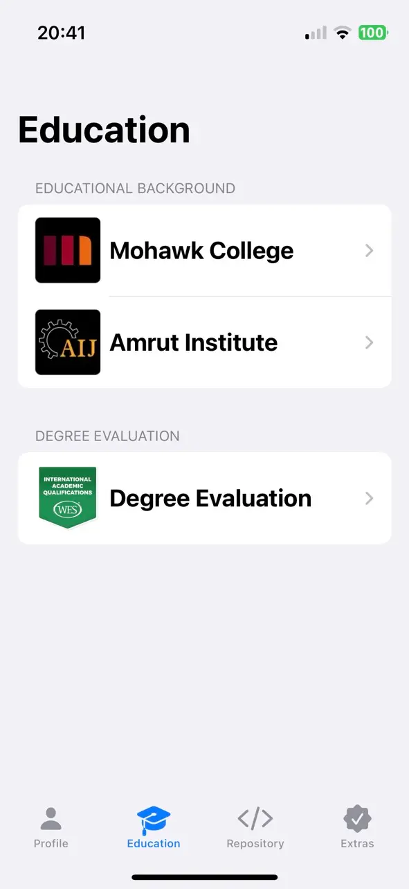 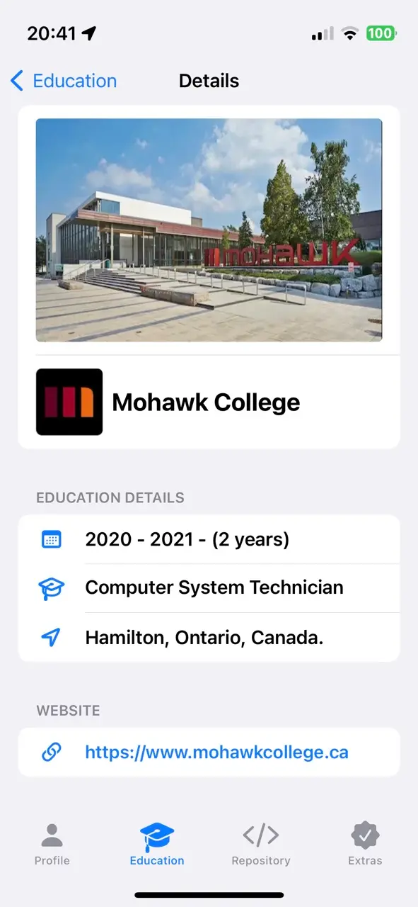
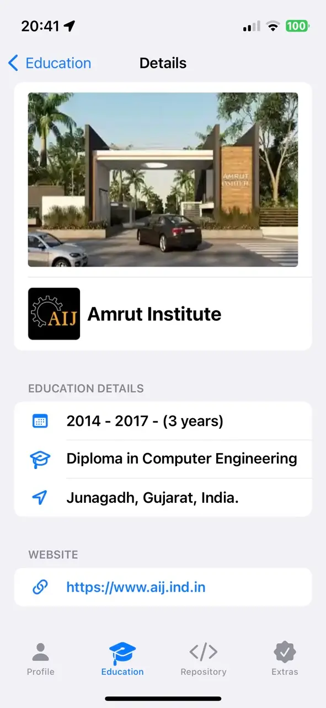 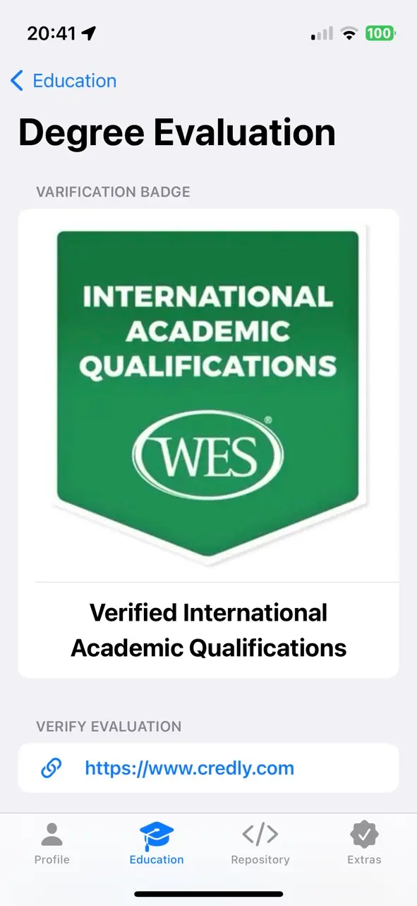
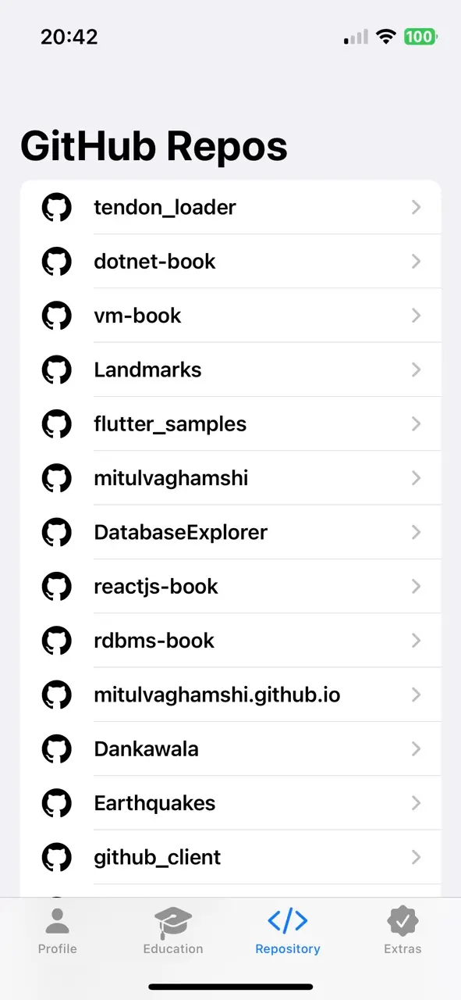 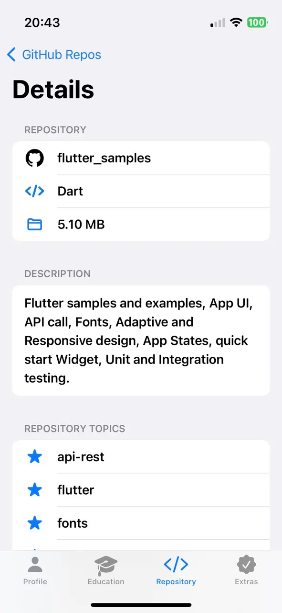
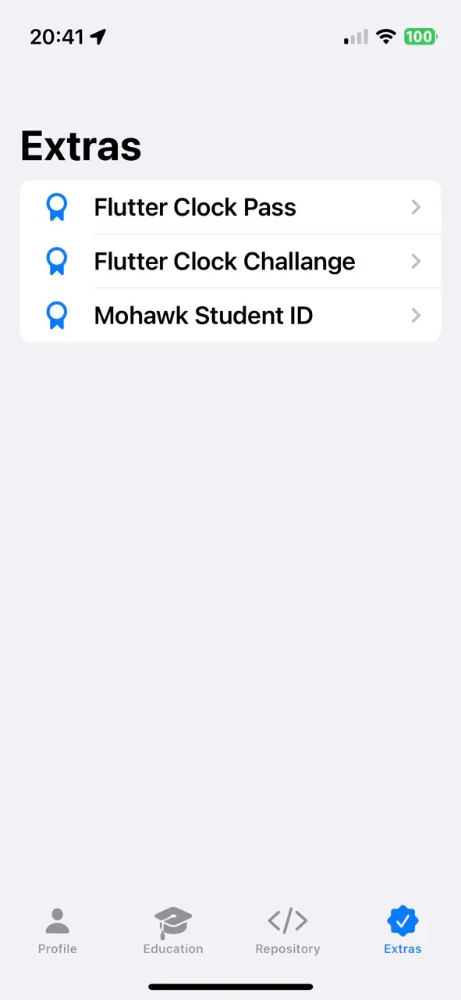 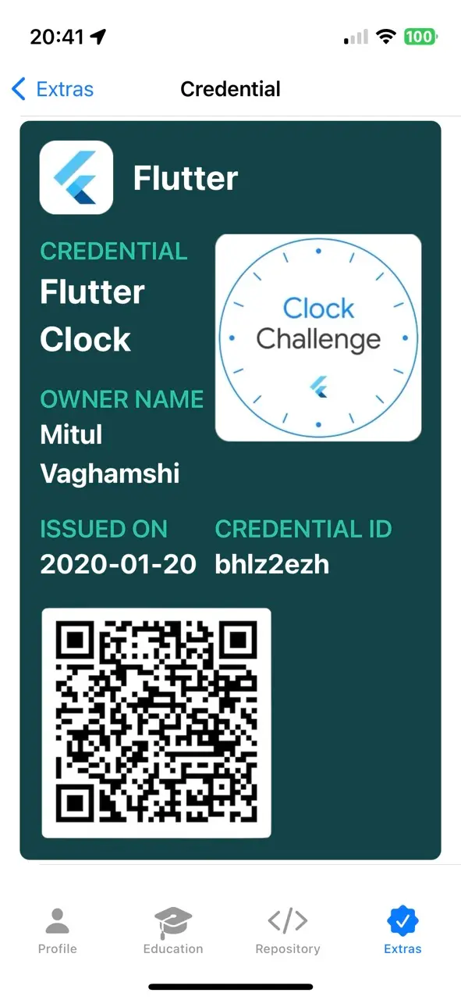
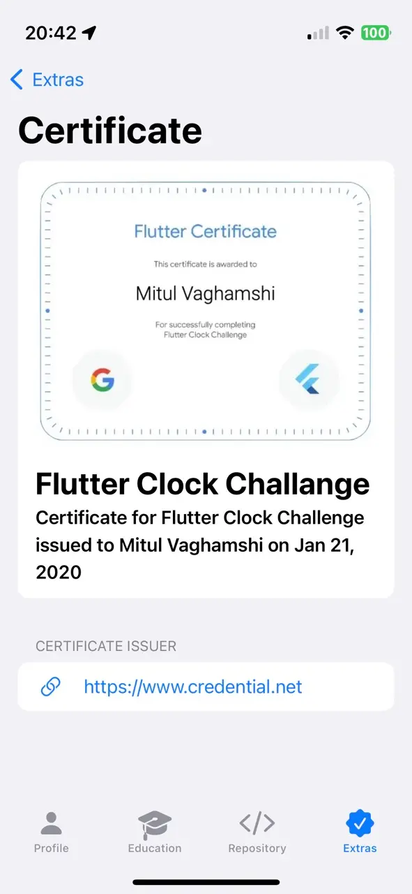 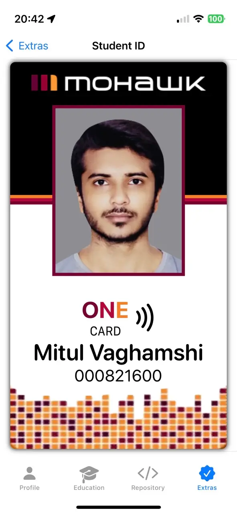
